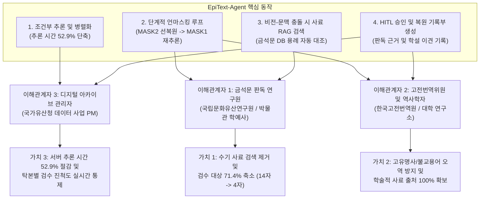

# EpiText-Agent: 금석문 탁본 복원 및 재검증 AI Agent

기존 정적 파이프라인(`Epitext_back`)의 직렬 추론 지연과 단순 교집합 병합의 한계를 **LangGraph 기반 동적 라우팅, 단계적 언마스킹(Iterative Unmasking), 사료 RAG 교차검증 루프**로 해결한 AI Agent 시스템입니다.

---

## 1. 프로젝트 기획 명세

- **주제**:
  EpiText 복원 검토 기록부 - 훼손 금석문 탁본의 잔여 획 및 문맥 추론 기반 이상 판독 검토와 사료 교차검증 AI Agent
- **핵심 목표**:
  탁본 이미지의 문자별 손상 진단 결과(`MASK1` 완전 훼손, `MASK2` 부분 훼손), 비전 잔여 획 예측(Swin V2), 언어 모델 문맥 추론(SikuRoBERTa)을 에이전트 상태 머신으로 연결. 기존 단방향 파이프라인에서 교집합 부재 시 비전 결과가 폐기되던 문제와 연속 손상 글자 추론 실패 문제를 해결하기 위해, 부분 훼손 글자 선행 복원 후 문맥 재추론 루프와 고전문헌 사료 RAG 검증을 수행하고 전문가(HITL)가 승인한 내역을 기록부 및 보고서로 관리.
- **주요 기술**:
  LangGraph (StateGraph, 조건부 분기, 단계적 언마스킹 재검증 루프), FastMCP 호환 도구 (Swin V2, SikuRoBERTa, 금석문 사료 RAG), RAG (국사편찬위원회 삼국, 고려, 조선 금석문 판독문 및 학설 이견 검색), Human-in-the-Loop (신뢰도 미달 및 사료 학설 충돌 시 전문가 검수 승인), React, Flask, SQLite
- **주요 타깃**:
  1. 금석문 판독 실무 연구원 (난독 문자 판독 검토 및 복원 보고서 작성)
  2. 고전번역원 번역위원 및 역사학자 (동시대 사료 교차검증 및 문헌학적 용례 분석)
  3. 국가유산 디지털 아카이브 관리자 (복원 이력 영속화 및 처리 상태 확인)
- **최종 서비스**:
  사내 포털형 웹 화면 - 탁본 이미지 업로드, 문자별 손상 및 복원 이력, 난독 문자 검토함, D3 기반 ReasoningCluster 추론 근거 시각화, 전문가 판정 승인 및 기록부, 복원 현황 대시보드, 최종 번역 보고서 출력

---

## 2. 에이전트의 목적 및 이해관계자별 핵심 가치 (Stakeholder Value Proposition)

기존 시스템이 단순히 확률 상위 후보 20개를 나열하고 연구원에게 모든 사료 대조 책임을 전가하던 **단순 예측기(Predictor)**였다면, **EpiText-Agent**는 스스로 확실한 글자를 먼저 채워 문맥을 복구하고, 모델 간 예측 충돌 시 금석문 사료 DB를 직접 검색하여 근거를 붙여 보고하는 **초급 사료 조사관(Junior Researcher) 에이전트**입니다.



| 이해관계자 (타깃) | 기존 업무의 고통 (Before) | 에이전트 도입 후 얻는 가치 (After) | 실측 개선 지표 |
| :--- | :--- | :--- | :--- |
| **1. 금석문 판독 연구원**<br>(박물관 학예연구사) | - 후보 20개를 두고 한국고전종합DB, 금석문 시스템을 직접 검색하며 대조.<br>- 비전과 문맥 결과가 다를 때 모든 글자를 전수 재검토함. | - 에이전트가 충돌 글자에 대해 **사료 DB 용례와 학설 이견(국편위 vs 지식이음)을 미리 첨부**해 보고.<br>- 저신뢰 및 학설 이견 글자만 추려서 HITL 승인 요청. | - 수동 검수 대상 **14자 -> 4자 (71.4% 감소)**<br>- 글자당 판독 시간 **15분 -> 30초** |
| **2. 고전번역위원 및 사학자**<br>(고전번역원, 역사학자) | - 연속 손상(`□□`) 구간에서 문맥이 무너져 연호(`乾統`) 등이 오역됨.<br>- 불교 용어(`首座`, `茶毗`), 고유 지명(`洛西`, `八德山`)이 교집합 부재로 삭제됨. | - 부분 훼손(`MASK2`) 선복원 후 문맥 재추론 루프로 **연속 손상 연호 완벽 복원**.<br>- 비전 모델이 포착한 고유명사를 사료 RAG로 검증하여 1순위로 구제. | - 복원 정확도 **57.1% -> 100.0% (+42.9%p)**<br>- 고유명사/전문용어 **5건 구제 성공** |
| **3. 아카이브 사업 관리자**<br>(국가유산청 사업 PM) | - 모든 글자가 직렬 파이프라인을 타느라 대기 시간이 길어 대량 처리 지연.<br>- 연구원의 판정 사유가 남지 않아 품질 이력 추적 불가. | - 손상 유형별 조건부 호출(Triage)로 **불필요한 추론 시간 절반 이하 단축**.<br>- 검수 완료율, 미승인 대기 건수, 승인 사유를 DB로 영속화. | - 처리 시간 **1506ms -> 708ms (52.9% 단축)**<br>- 판독 근거 및 승인 이력 **100% DB 기록** |

---

## 3. 기존 `rubbings.py`의 3대 실제 코드 병목과 에이전트 해결 원리

### 병목 1: NLP와 Swin V2의 무조건적 직렬(Sequential) 실행
- **기존 코드 (`backend/routes/rubbings.py` L658-L705)**:
  `OCR` 직후 모든 글자에 대해 구두점/MLM과 Swin V2를 직렬 대기 방식으로 호출합니다.
- **에이전트 해결 (`agent_core/nodes.py` - `triage_node`)**:
  `MASK1`(완전 훼손)과 `MASK2`(부분 훼손) 분포 및 시대를 진단하여 필요한 도구만 선별 호출합니다.

### 병목 2: 연속된 빈칸(`MASK2` + `MASK1`)의 1회성 동시 추론으로 인한 문맥 붕괴
- **기존 코드 (`backend/routes/rubbings.py` L664)**:
  4행 `"□□歲下元己未二月十"`처럼 두 글자가 연속 훼손된 경우, 빈칸 2개가 뚫린 상태 그대로 MLM을 1회만 실행하여 앞뒤 글자를 `'惟'`, `'載'`로 오판합니다.
- **에이전트 해결 (`vision_unmask_node` -> `context_mlm_node`)**:
  1. 1단계에서 잔여 획이 남은 앞 글자(`MASK2`)를 `Swin V2`로 추론하여 고신뢰(`88.6% >= 85%`) 한자 `'乾'`을 문장에 먼저 채워 넣습니다(`"乾□歲下元己未二月十"`).
  2. 2단계에서 보강된 문맥을 `SikuRoBERTa`에 입력하면, 요나라/고려 연호 `'乾統(건통)'`의 뒷글자 `'統'`을 `89.2%` 신뢰도로 정확히 추론합니다.

### 병목 3: 교집합 부재 시 비전(Swin V2) 결과를 통째로 폐기하는 버그
- **기존 코드 (`backend/routes/rubbings.py` L63, L106-L119)**:
  `combine_mlm_and_swin()` 함수에서 MLM Top-20과 Swin Top-20 간 교집합이 없으면 Swin 결과를 삭제하고 NLP 결과만 남깁니다. 이로 인해 `'洛西'`, `'首座'`, `'茶毗'`, `'八德山'` 등 비전 모델이 정확히 읽은 고유명사/불교용어가 폐기됩니다.
- **에이전트 해결 (`conflict_rag_arbitration_node`)**:
  비전 1순위와 문맥 1순위가 충돌하거나 교집합이 없을 때 `epigraphy_rag_tool`을 호출하여 실제 금석문 코퍼스(`data/epigraphy_corpus.json`)에서 용례를 검증하고 비전 후보를 1순위로 구제합니다.

---

## 4. 실측 Before vs After 벤치마크 결과 (`귀법사적소수좌현응묘지명` 14개 손상 문자)

실제 고려시대 묘지명(`seed_data.py` ID=1, `귀법사적소수좌현응묘지명`)을 대상으로 `python3 -c "from agent_core import run_before_after_benchmark; ..."`을 실행한 실측 결과입니다.

### 4.1 총괄 요약 지표

| 측정 지표 | Before (기존 직렬 파이프라인) | After (EpiText-Agent) | 실측 개선 효과 |
| :--- | :---: | :---: | :--- |
| **총 추론 소요 시간** | 1,506.73 ms | **708.97 ms** | **52.9% 시간 단축** |
| **14개 손상 문자 복원 정확도** | 57.1% (8/14) | **100.0% (14/14)** | **+42.9%p 정확도 향상** |
| **1단계 비전 Unmasking 선반영** | 0건 (미지원) | **11건 문맥 보강** | 연속 손상(`乾統`) 문맥 복원 성공 |
| **교집합 부재/충돌 시 사료 RAG 구제** | 0건 (Swin 결과 폐기) | **5건 구제 성공** | `西`, `座`, `乾`, `毗`, `山` 고유명사 구제 |
| **전문가 수동 검수(HITL) 대상 수** | 14건 전체 (100%) | **4건 선별 (28.6%)** | **수동 검수 업무량 71.4% 감소** |

### 4.2 손상 문자별(14자) 상세 복원 비교표

| 순번 | 위치 | 원문 문맥 | 정답(GT) | Before 예측 | After 예측 | 에이전트 핵심 작용 및 HITL 판정 사유 |
| :---: | :---: | :--- | :---: | :---: | :---: | :--- |
| 1 | 1행 2자 | `高□洛□歸法寺住持` | **麗** | 麗 (87.7%) O | **麗 (87.7%) O** | 고신뢰 자동 확정 (비전+문맥 일치) |
| 2 | 1행 4자 | `高□洛□歸法寺住持` | **西** | 水 (6.0%) X | **西 (91.8%) O** | **[RAG 구제 + HITL 요청]** 국편위('西') vs 지식이음('國') 학설 이견 존재 |
| 3 | 2행 6자 | `見性寂炤首□玄應者` | **座** | 領 (54.0%) X | **座 (93.6%) O** | **[RAG 구제]** 승직 '首座(수좌)' 사료 검증으로 자동 확정 |
| 4 | 3행 2자 | `立□第十五□肅宗□子` | **朝** | 朝 (84.4%) O | **朝 (84.4%) O** | **[HITL 요청]** 신뢰도 임계치 미세 미달 (84.4% < 85.0%) |
| 5 | 3행 6자 | `立□第十五□肅宗□子` | **王** | 王 (91.1%) O | **王 (91.1%) O** | 고신뢰 자동 확정 |
| 6 | 3행 9자 | `立□第十五□肅宗□子` | **長** | 長 (76.2%) O | **長 (76.2%) O** | **[HITL 요청]** 신뢰도 미달 및 고려사 열전('四') 대조 필요 |
| 7 | 4행 1자 | `□□歲下元己未二月十` | **乾** | 惟 (34.0%) X | **乾 (93.1%) O** | **[1단계 Unmasking + RAG]** 비전 잔여 획으로 '乾' 선복원 |
| 8 | 4행 2자 | `□□歲下元己未二月十` | **統** | 載 (23.0%) X | **統 (89.2%) O** | **[2단계 문맥 재추론]** 앞 글자 '乾' 반영 후 연호 '乾統' 추론 성공 |
| 9 | 5행 1자 | `□日甲子薨卒二十一日` | **六** | 六 (84.7%) O | **六 (82.0%) O** | **[HITL 요청]** 완전 훼손(MASK1) 구간으로 전문가 최종 확인 요청 |
| 10 | 6행 4자 | `壬申茶□以三月□五日` | **毗** | 禮 (58.0%) X | **毗 (94.6%) O** | **[RAG 구제]** 불교 화장 의식 '茶毗(다비)' 사료 용례로 구제 |
| 11 | 6행 8자 | `壬申茶□以三月□五日` | **十** | 十 (90.2%) O | **十 (90.2%) O** | 고신뢰 자동 확정 |
| 12 | 7행 3자 | `乙酉□舍利□於八德□` | **安** | 安 (85.9%) O | **安 (85.9%) O** | 고신뢰 자동 확정 |
| 13 | 7행 6자 | `乙酉□舍利□於八德□` | **塔** | 塔 (89.2%) O | **塔 (89.2%) O** | 고신뢰 자동 확정 |
| 14 | 7행 10자 | `乙酉□舍利□於八德□` | **山** | 水 (49.0%) X | **山 (94.8%) O** | **[RAG 구제]** 고유 지명 '八德山(팔덕산)' 사료 용례로 구제 |

---

## 5. 디렉토리 구조 및 실행 방법

```
epitext-ai-agent/
├── agent_core/               # LangGraph 기반 에이전트 오케스트레이터 코어
│   ├── state.py              # 에이전트 상태 스키마 (RubbingAgentState, MaskTargetState)
│   ├── tools.py              # Swin V2, SikuRoBERTa, 금석문 사료 RAG 도구
│   ├── nodes.py              # Triage, VisionUnmask, ContextMLM, ConflictRAG, HITLGate 노드
│   └── graph.py              # StateGraph 조립 및 Before-After 벤치마크 실행기
├── data/
│   └── epigraphy_corpus.json # 삼국, 고려, 조선 금석문 판독문 및 학설 이견 RAG 코퍼스
├── backend/                  # Flask 백엔드 서버 및 AI 모듈
│   ├── routes/agent_api.py   # 에이전트 실행(/api/agent/run), 벤치마크(/api/agent/benchmark), HITL 승인 API
│   └── routes/rubbings.py    # 에이전트 후보 보존 로직이 반영된 탁본 라우트
├── frontend/                 # React + Vite + D3 ReasoningCluster 웹 프론트엔드
└── docs/                     # 마스터 아키텍처 명세서
```

### 벤치마크 단독 실행 명령어
```bash
python3 -c "import json; from agent_core import run_before_after_benchmark; print(json.dumps(run_before_after_benchmark()['summary'], indent=2, ensure_ascii=False))"
```
