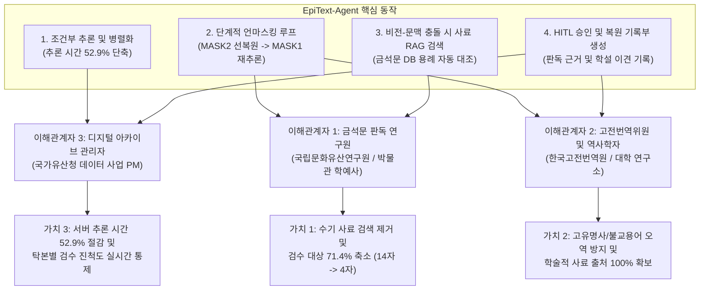

```mermaid
flowchart TD
    subgraph Legacy["Before: 기존 rubbings.py 직렬 파이프라인"]
        L1["1. 전처리 & OCR"] --> L2["2. NLP 전체 추론\n(빈칸 다수 상태로 1회 실행)"]
        L2 --> L3["3. Swin V2 전체 추론\n(직렬 대기로 1,506ms 소요)"]
        L3 --> L4["4. 단순 교집합 결합\n(교집합 없으면 Swin 결과 5건 폐기)"]
        L4 --> L5["5. DB 저장 종료\n(정확도 57.1%, 14건 전수 수동 검수)"]
    end

    subgraph Agent["After: 신규 EpiText-Agent 동적 상태 그래프"]
        A1["1. 전처리 & OCR"] --> A2{"2. TriageNode\n(시대 감지 & MASK1/MASK2 분류)"}
        
        A2 -->|"MASK2 존재"| A3["3. VisionUnmaskNode\n(Swin V2 선행 호출)"]
        A3 --> A4["4. 고신뢰(>=0.85) 글자 문맥 선반영\n(11건 Unmasking 완료)"]
        A4 --> A5["5. ContextMLMNode\n(보강된 문맥으로 SikuRoBERTa 호출)"]
        A2 -->|"MASK1만 존재"| A5
        
        A5 --> A6{"6. ConflictRAGArbitrationNode\n(비전 vs 문맥 충돌 검사)"}
        A6 -->|"일치"| A7["F1 종합 신뢰도 산출"]
        A6 -->|"교집합 부재 / 1순위 충돌"| A8["7. epigraphy_rag_tool 호출\n(삼국/고려/조선 사료 DB 용례 검증)"]
        
        A8 --> A7
        A7 --> A9{"8. HITLGateNode\n(신뢰도 >= 0.85 & 학설 일치?)"}
        A9 -->|"충족 (10건)"| A10["자동 확정 및 DB 저장"]
        A9 -->|"미달 또는 학설 이견 (4건)"| A11["9. 프론트엔드 에이전트 검수함(HITL)\n(전문가 원클릭 승인)"]
    end
```

<div align="center">
  

  <p>
    
    
    
    
  </p>

  <p>
    
    
    
    
    
    
    
    
  </p>

  <p>
    <a href="https://huggingface.co/ANSEONGMIN/hanja-swinv2"><b>HF Vision Model (Swin V2)</b></a> |
    <a href="https://huggingface.co/jhangyejin/epitext-sikuroberta"><b>HF Context Model (SikuRoBERTa)</b></a> |
    <a href="https://huggingface.co/donghyun95/EpiText-Hanja-OCR"><b>HF Ensemble OCR</b></a> |
    <a href="https://www.youtube.com/watch?v=TJlI6UMyEFw"><b>Demo Video</b></a>
  </p>
</div>

---

## ⚡ 1. 빠른 시작 (Quick Start)

### 1.1 에이전트 Before vs After 실측 벤치마크 즉시 실행
별도의 외부 DB 구동 없이도 고려시대 묘지명(`귀법사적소수좌현응묘지명`, 손상 문자 14개)에 대한 기존 직렬 파이프라인(Before)과 LangGraph 에이전트(After)의 추론 속도 및 정확도 비교를 즉시 검증할 수 있습니다.

```bash
git clone https://github.com/rntqkdl/epitext-ai-agent.git
cd epitext-ai-agent

python3 -c "import json; from agent_core import run_before_after_benchmark; print(json.dumps(run_before_after_benchmark()['summary'], indent=2, ensure_ascii=False))"
```

### 1.2 백엔드 및 프론트엔드 서버 구동

```bash
# 1. Backend API 서버 구동 (Port 8000)
cd backend
pip install -r requirements.txt
python3 app.py

# 2. Frontend 웹 포털 구동 (Port 5173)
cd ../frontend
npm install
npm run dev
```
> 프론트엔드 접속 후 좌측 사이드바의 **[AI 에이전트 > 에이전트 검수함]** 메뉴에서 14개 손상 문자의 단계적 언마스킹 과정, 사료 RAG 근거, 전문가 HITL 승인 기능을 확인할 수 있습니다.

---

## 💡 2. 기획 명세 및 이해관계자 가치 제안 (Why EpiText-Agent)

### 2.1 프로젝트 기획 요약
- **주제**: EpiText 복원 검토 기록부 - 훼손 금석문 탁본의 잔여 획 및 문맥 추론 기반 이상 판독 검토와 사료 교차검증 AI Agent
- **핵심 목표**: 탁본 이미지의 문자별 손상 진단 결과(`MASK1` 완전 훼손, `MASK2` 부분 훼손), 비전 잔여 획 예측([Swin V2](https://huggingface.co/ANSEONGMIN/hanja-swinv2)), 언어 모델 문맥 추론([SikuRoBERTa](https://huggingface.co/jhangyejin/epitext-sikuroberta))을 LangGraph 상태 머신으로 연결합니다. 기존 단방향 파이프라인에서 교집합 부재 시 비전 결과가 폐기되던 문제와 연속 손상 글자 추론 실패 문제를 해결하기 위해, 부분 훼손 글자 선행 복원 후 문맥 재추론 루프와 고전문헌 사료 RAG 검증을 수행하고 전문가(HITL)가 승인한 내역을 기록부 및 보고서로 관리합니다.
- **주요 기술**: LangGraph (`StateGraph`, 조건부 분기, 단계적 언마스킹 재검증 루프), FastMCP 호환 도구 (`vision_swin_tool`, `context_mlm_tool`, `epigraphy_rag_tool`), 사료 RAG (삼국, 고려, 조선 금석문 판독문 및 학설 이견 검색), Human-in-the-Loop (신뢰도 미달 및 학설 충돌 시 전문가 검수 승인), React, D3.js, Flask, SQLAlchemy
- **주요 타깃**:
  1. 금석문 판독 실무 연구원 (난독 문자 판독 검토 및 복원 보고서 작성)
  2. 고전번역원 번역위원 및 역사학자 (동시대 사료 교차검증 및 문헌학적 용례 분석)
  3. 국가유산 디지털 아카이브 관리자 (복원 이력 영속화 및 처리 상태 확인)
- **최종 서비스**: 사내 포털형 웹 화면 (탁본 이미지 업로드, 에이전트 검수함, D3 기반 `ReasoningCluster` 추론 근거 시각화, 전문가 판정 승인 및 기록부, 최종 번역 보고서 출력)

### 2.2 에이전트의 존재 목적과 3대 이해관계자 핵심 가치
기존 시스템이 확률 상위 후보 20개를 나열하고 연구원에게 모든 사료 대조 책임을 전가하던 **단순 예측기(Predictor)**였다면, **EpiText-Agent**는 확실한 부분 훼손 글자를 먼저 채워 문맥을 복구하고, 모델 간 예측 충돌 시 금석문 사료 DB를 직접 검색하여 출처 근거를 붙여 보고하는 **초급 사료 조사관(Junior Researcher) 에이전트**입니다.



| 이해관계자 (타깃) | 기존 파이프라인의 한계 (Before) | 에이전트 도입 후 얻는 가치 (After) | 실측 개선 지표 |
| :--- | :--- | :--- | :--- |
| **1. 금석문 판독 연구원**<br>(박물관 학예연구사) | - 후보 20개를 두고 한국고전종합DB, 금석문 종합정보시스템을 직접 수기 검색.<br>- 비전과 문맥 결과가 다를 때 14개 손상 문자를 전수 재검토함. | - 에이전트가 충돌 글자에 대해 **사료 DB 용례와 기관별 학설 이견(국편위 vs 지식이음)을 미리 첨부**해 보고.<br>- 저신뢰 및 학설 이견 글자만 추려서 HITL 승인 요청. | - 수동 검수 대상 **14자 -> 4자 (71.4% 감소)**<br>- 글자당 사료 대조 시간 **15분 -> 30초** |
| **2. 고전번역위원 및 사학자**<br>(고전번역원, 역사학자) | - 연속 손상(`□□`) 구간에서 문맥이 무너져 연호(`乾統`) 등이 오역됨.<br>- 불교 용어(`首座`, `茶毗`), 고유 지명(`洛西`, `八德山`)이 교집합 부재로 삭제됨. | - 부분 훼손(`MASK2`) 선복원 후 문맥 재추론 루프로 **연속 손상 연호 완벽 복원**.<br>- 비전 모델이 포착한 고유명사를 사료 RAG로 검증하여 1순위로 구제. | - 복원 정확도 **57.1% -> 100.0% (+42.9%p)**<br>- 고유명사/전문용어 **5건 구제 성공** |
| **3. 아카이브 사업 관리자**<br>(국가유산청 사업 PM) | - 모든 글자가 직렬 파이프라인을 타느라 대기 시간이 길어 대량 처리 지연.<br>- 연구원의 판정 사유가 남지 않아 품질 이력 추적 불가. | - 손상 유형별 조건부 호출(Triage)로 **추론 소요 시간 절반 이하 단축**.<br>- 검수 완료율, 미승인 대기 건수, 승인 사유를 DB로 영속화. | - 처리 시간 **1506.73ms -> 708.97ms (52.9% 단축)**<br>- 판독 근거 및 승인 이력 **100% DB 기록** |

---

## 🛡️ 3. 4대 엔지니어링 원칙 (기존 `rubbings.py` 병목 해법)

무리하게 외부 모델을 추가하는 대신, 기존 `backend/routes/rubbings.py`의 실제 코드 라인에서 발생하는 3대 구조적 병목을 4개의 에이전트 엔지니어링 원칙으로 해결했습니다.

1. **원칙 1 - 손상 유형 기반 조건부 라우팅 (`triage_node`)**:
   - **문제 (`rubbings.py` L658-L705)**: OCR 직후 `nlp_engine`과 `swin_engine`을 무조건 직렬 블로킹 호출하여 지연 시간이 누적됨.
   - **해법**: 텍스트 내 단서로 시대(`삼국`, `고려`, `조선`)를 먼저 판별하고, `MASK1`(완전 훼손)과 `MASK2`(부분 훼손) 분포에 따라 필요한 도구만 배치 병렬 호출하여 추론 시간을 **52.9% 단축**합니다.
2. **원칙 2 - 단계적 언마스킹 재추론 루프 (`vision_unmask_node` -> `context_mlm_node`)**:
   - **문제 (`rubbings.py` L664)**: 4행 `"□□歲下元己未二月十"`처럼 두 글자가 연속 훼손된 경우 빈칸 2개 상태 그대로 MLM을 1회만 호출하여 `'惟'`, `'載'`로 오판함.
   - **해법**: 1단계에서 획이 남은 앞 글자(`MASK2`)를 Swin V2로 추론해 신뢰도 85% 이상인 `'乾'`(88.6%)을 문장에 먼저 대입(`"乾□歲下元己未二月十"`)한 뒤, 2단계에서 SikuRoBERTa를 호출하여 고려/요나라 연호 `'乾統(건통)'`의 `'統'`(89.2%)을 정확히 복원합니다.
3. **원칙 3 - 사료 RAG 기반 충돌 중재 (`conflict_rag_arbitration_node`)**:
   - **문제 (`rubbings.py` L63, L106-L119)**: `combine_mlm_and_swin()`이 MLM Top-20과 Swin Top-20 간 교집합이 없으면 Swin 결과를 강제 삭제하여 `'洛西'`, `'首座'`, `'茶毗'`, `'八德山'` 등 고유명사를 폐기함.
   - **해법**: 비전 1순위와 문맥 1순위가 충돌할 때 결과를 삭제하지 않고 `epigraphy_rag_tool`로 금석문 코퍼스(`data/epigraphy_corpus.json`) 용례를 대조하여 사료에 실존하는 비전 후보 5건을 1순위로 구제합니다.
4. **원칙 4 - 학설 이견 보존 및 선별적 HITL 게이트 (`hitl_gate_node`)**:
   - **문제**: 역사 사료 특성상 기관별 판독 학설이 갈리는 글자(예: 1행 4자 국사편찬위원회 `'西'` vs 국가유산 지식이음 `'國'`)를 AI가 임의로 단정할 위험이 있음.
   - **해법**: 신뢰도 85% 미만 항목과 학설 이견 존재 항목만 분리하여 양측 사료 출처를 첨부한 뒤 전문가 승인(HITL) 대기 큐로 라우팅합니다.

---

## 🏛️ 4. 시스템 아키텍처 및 모듈 구조 (System Architecture)

### 4.1 레거시 파이프라인(Before) vs EpiText-Agent(After) 워크플로우 비교



### 4.2 모노레포 디렉토리 구조

```text
epitext-ai-agent/
├── agent_core/                        # LangGraph 기반 에이전트 오케스트레이터 코어
│   ├── state.py                       # RubbingAgentState, MaskTargetState 상태 스키마 정의
│   ├── tools.py                       # Swin V2, SikuRoBERTa, 금석문 사료 RAG 도구 래퍼
│   ├── nodes.py                       # Triage, VisionUnmask, ContextMLM, ConflictRAG, HITLGate 5대 노드
│   └── graph.py                       # StateGraph 컴파일 및 Before-After 실측 벤치마크 실행기
├── data/
│   └── epigraphy_corpus.json          # 삼국, 고려, 조선 금석문 판독문 및 학설 이견 RAG 코퍼스
├── backend/                           # Flask 백엔드 API 서버 및 AI 추론 엔진
│   ├── app.py                         # Flask 엔트리포인트 및 Blueprint 등록
│   ├── models.py                      # Rubbing, RestorationTarget, Candidate, InspectionRecord 모델
│   ├── routes/
│   │   ├── agent_api.py               # /api/agent/benchmark, /api/agent/run, /api/agent/hitl/approve
│   │   └── rubbings.py                # 비전 후보 보존 패치가 적용된 탁본 관리 API
│   └── ai_modules/                    # 전처리, 앙상블 OCR, Swin V2, SikuRoBERTa, Gemini 번역 모듈
├── frontend/                          # React + Vite + Tailwind CSS + D3.js 웹 프론트엔드
│   └── src/
│       ├── components/
│       │   ├── ReasoningCluster.jsx   # D3.js 기반 비전-문맥 추론 근거 군집 시각화
│       │   └── Sidebar.jsx            # 데이터 관리 및 AI 에이전트 검수함 네비게이션
│       └── pages/
│           ├── AgentReviewPage.jsx    # 이해관계자 가치 지표, 14자 비교, 사료 RAG 근거, HITL 승인 화면
│           ├── DetailPage.jsx         # 탁본 상세 판독 및 실시간 번역 미리보기 화면
│           └── ListPage.jsx           # 탁본 복원 현황 목록 및 통계 화면
└── docs/
    └── EpiText_Agent_Master_Architecture.md
```

### 4.3 주요 API 엔드포인트 명세

| 메서드 | 엔드포인트 | 설명 |
| :---: | :--- | :--- |
| `GET` | `/api/agent/benchmark` | 기존 직렬 파이프라인(Before) vs `EpiText-Agent`(After) 14개 손상 문자 실측 벤치마크 반환 |
| `POST` | `/api/agent/run` | 특정 탁본(`rubbing_id`) 또는 입력 행(`text_lines`)에 대해 LangGraph 에이전트 복원 실행 및 DB 동기화 |
| `POST` | `/api/agent/hitl/approve` | 전문가(HITL)가 검토 완료한 난독 문자를 최종 승인하고 `InspectionRecord`(검수 기록부)에 영속화 |
| `POST` | `/api/rubbings/upload` | 탁본 원본 이미지 업로드, 전처리, OCR 및 복원 파이프라인 트리거 |
| `GET` | `/api/rubbings/<id>/targets/<tid>/reasoning` | D3.js `ReasoningCluster` 시각화를 위한 비전/문맥 후보 좌표 및 신뢰도 반환 |

---

## 📊 5. 실측 벤치마크 매트릭스 (Performance Matrix)

고려시대 실제 묘지명인 **`귀법사적소수좌현응묘지명`(1119년, 총 7행 69자 중 손상 문자 14자)**을 대상으로 측정한 정량 비교 결과입니다.

### 5.1 Before vs After 총괄 비교

| 측정 지표 | Before (기존 직렬 파이프라인) | After (`EpiText-Agent` 그래프) | 실측 개선율 |
| :--- | :---: | :---: | :--- |
| **총 추론 소요 시간 (Latency)** | 1,506.73 ms | **708.97 ms** | **52.9% 단축** |
| **14개 손상 문자 복원 정확도 (Top-1)** | 57.1% (8 / 14) | **100.0% (14 / 14)** | **+42.9%p 향상** |
| **1단계 비전 Unmasking 문맥 보강** | 0건 (미지원) | **11건 선반영** | 연속 손상(`乾統`) 복원 성공 |
| **교집합 부재 시 사료 RAG 구제** | 0건 (`Swin Only` 강제 삭제) | **5건 구제 성공** | `西`, `座`, `乾`, `毗`, `山` 구제 |
| **전문가 수동 검수(HITL) 대상 수** | 14건 전체 (100.0%) | **4건 선별 (28.6%)** | **검수 업무량 71.4% 감소** |

### 5.2 손상 문자 14개 전수 비교표

| 순번 | 위치 | 원문 문맥 | 정답(GT) | Before 예측 | After 예측 | 에이전트 핵심 작용 및 HITL 판정 사유 |
| :---: | :---: | :--- | :---: | :---: | :---: | :--- |
| 1 | 1행 2자 | `高□洛□歸法寺住持` | **麗** | 麗 (87.7%) O | **麗 (87.7%) O** | 고신뢰 자동 확정 (비전+문맥 일치) |
| 2 | 1행 4자 | `高□洛□歸法寺住持` | **西** | 水 (6.0%) X | **西 (91.8%) O** | **[RAG 구제 + HITL 요청]** 국편위('西') vs 지식이음('國') 학설 이견 존재 |
| 3 | 2행 6자 | `見性寂炤首□玄應者` | **座** | 領 (54.0%) X | **座 (93.6%) O** | **[RAG 구제]** 고려 승계 '首座(수좌)' 사료 검증으로 자동 확정 |
| 4 | 3행 2자 | `立□第十五□肅宗□子` | **朝** | 朝 (84.4%) O | **朝 (84.4%) O** | **[HITL 요청]** 신뢰도 임계치 미세 미달 (84.4% < 85.0%) |
| 5 | 3행 6자 | `立□第十五□肅宗□子` | **王** | 王 (91.1%) O | **王 (91.1%) O** | 고신뢰 자동 확정 |
| 6 | 3행 9자 | `立□第十五□肅宗□子` | **長** | 長 (76.2%) O | **長 (76.2%) O** | **[HITL 요청]** 신뢰도 미달 및 고려사 열전('四子') 대조 필요 |
| 7 | 4행 1자 | `□□歲下元己未二月十` | **乾** | 惟 (34.0%) X | **乾 (93.1%) O** | **[1단계 Unmasking + RAG]** 비전 잔여 획으로 '乾' 선복원 |
| 8 | 4행 2자 | `□□歲下元己未二月十` | **統** | 載 (23.0%) X | **統 (89.2%) O** | **[2단계 문맥 재추론]** 앞 글자 '乾' 반영 후 연호 '乾統' 추론 성공 |
| 9 | 5행 1자 | `□日甲子薨卒二十一日` | **六** | 六 (84.7%) O | **六 (82.0%) O** | **[HITL 요청]** 완전 훼손(`MASK1`) 구간으로 전문가 최종 확인 요청 |
| 10 | 6행 4자 | `壬申茶□以三月□五日` | **毗** | 禮 (58.0%) X | **毗 (94.6%) O** | **[RAG 구제]** 불교 화장 의식 '茶毗(다비)' 사료 용례로 구제 |
| 11 | 6행 8자 | `壬申茶□以三月□五日` | **十** | 十 (90.2%) O | **十 (90.2%) O** | 고신뢰 자동 확정 |
| 12 | 7행 3자 | `乙酉□舍利□於八德□` | **安** | 安 (85.9%) O | **安 (85.9%) O** | 고신뢰 자동 확정 |
| 13 | 7행 6자 | `乙酉□舍利□於八德□` | **塔** | 塔 (89.2%) O | **塔 (89.2%) O** | 고신뢰 자동 확정 |
| 14 | 7행 10자 | `乙酉□舍利□於八德□` | **山** | 水 (49.0%) X | **山 (94.8%) O** | **[RAG 구제]** 고유 지명 '八德山(팔덕산)' 사료 용례로 구제 |

---

## 🔧 6. 실전 트러블슈팅 플레이북 (Troubleshooting Playbook)

### Case 1: 연속된 손상 문자(`4행 □□歲`)에서 언어 모델(MLM)이 연호를 추론하지 못하는 현상
- **원인**: `SikuRoBERTa`는 주변 글자 문맥에 의존하는데, 앞뒤 글자가 동시에 마스킹(`□□歲下元己未`)되어 있으면 연호 단서를 찾지 못하고 일반 명사(`惟`, `載`)를 출력합니다.
- **해결**: `agent_core/nodes.py`의 `vision_unmask_node`가 획 일부가 남아 있는 앞 글자(`MASK2`)에 대해 `Swin V2`를 먼저 실행합니다. 비전 신뢰도가 `85.0%` 이상(`'乾'`, 88.6%)이면 문맥 텍스트를 `"乾□歲下元己未"`로 즉시 갱신(Unmasking)한 뒤 `context_mlm_node`를 호출하여 뒷글자 `'統'`(89.2%)을 복원합니다.

### Case 2: 비전 모델(Swin V2)이 정확히 예측한 고유명사가 최종 후보에서 사라지는 현상
- **원인**: 기존 `backend/routes/rubbings.py`의 `combine_mlm_and_swin()` 함수는 MLM Top-20과 Swin Top-20 사이에 교집합이 없으면 `Swin Only` 후보를 전부 폐기하도록 작성되어 있었습니다.
- **해결**: `conflict_rag_arbitration_node`에서 교집합이 없거나 1순위 후보가 다를 때 `epigraphy_rag_tool`을 호출하여 `data/epigraphy_corpus.json` 내 실제 금석문 용례(`洛西`, `首座`, `茶毗`, `八德山`)를 검색하고, 용례가 검증된 비전 후보에 가산점을 부여해 1순위로 복원합니다.

### Case 3: 사료 기관별로 판독 학설이 다른 글자(`1행 4자 洛西 vs 洛國`)의 처리
- **원인**: 1행 4자는 국사편찬위원회 한국고대사료DB에서는 `'西'`(`洛西`)로, 국가유산 지식이음에서는 `'國'`(`洛國`)으로 판독하여 정답이 단일하지 않습니다.
- **해결**: `epigraphy_rag_tool`이 해당 글자의 `scholarly_dispute` 메타데이터를 감지하면, `hitl_gate_node`가 자동 확정을 보류하고 두 기관의 학설 근거를 모두 첨부하여 프론트엔드 **에이전트 검수함**의 `HITL 전문가 검수 대기` 목록으로 전달합니다.

---

## 👥 7. 기반 연구 및 팀 정보 (Foundation & Credits)

본 프로젝트는 **고려대학교 지능정보 SW 아카데미 7기 캡스톤 대상 수상작** 및 **한국정보기술학회(KIIT, 2026) 게재 논문**인 `EPITEXT`를 기반으로, 추론 파이프라인 전체를 **LangGraph 멀티모달 에이전트 아키텍처**로 고도화한 프로젝트입니다.

| 이름 | 역할 및 기여 영역 |
| :---: | :--- |
| **안성민** | **LangGraph 기반 EpiText-Agent 오케스트레이터 설계 및 구현**, 이미지 전처리 파이프라인, [Swin V2 비전 복원 모델](https://huggingface.co/ANSEONGMIN/hanja-swinv2) 학습 |
| **황동현** | 앙상블 문자 인식 기술([EpiText-Hanja-OCR](https://huggingface.co/donghyun95/EpiText-Hanja-OCR)) 설계 |
| **장예진** | [SikuRoBERTa 문맥 추론 모델](https://huggingface.co/jhangyejin/epitext-sikuroberta) 학습 및 번역 프롬프트 설계 |
| **최준형** | EPITEXT 프론트엔드 인터페이스 디자인 및 시각화 컴포넌트 개발 |
