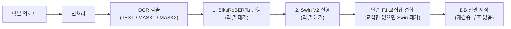
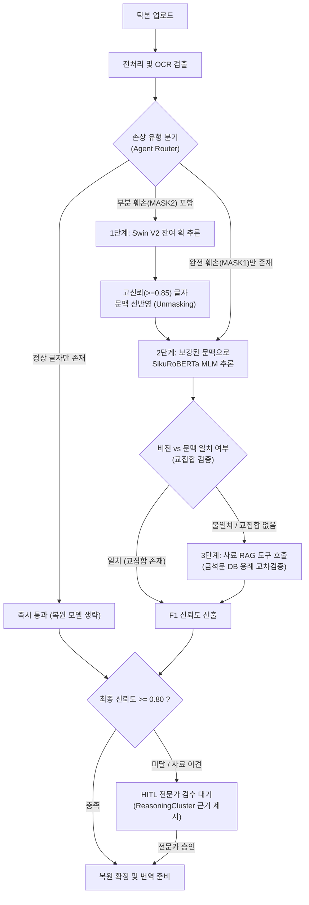

# EpiText-Agent: 금석문 탁본 복원 및 재검증 AI Agent

기존 정적 파이프라인(`Epitext_back`)의 직렬 추론 지연과 단순 교집합 병합의 한계를 **LangGraph 기반 동적 라우팅, 병렬 실행, 다단계 재검증 루프(Iterative Re-verification Loop)**로 해결한 AI Agent 시스템입니다.

---

## 1. 프로젝트 기획 명세

- **주제**:
  EpiText 복원 검토 기록부 - 훼손 금석문 탁본의 잔여 획 및 문맥 추론 기반 이상 판독 검토와 사료 교차검증 AI Agent
- **핵심 목표**:
  탁본 이미지의 문자별 손상 진단 결과(`MASK1` 완전 훼손, `MASK2` 부분 훼손), 비전 잔여 획 예측(Swin V2), 언어 모델 문맥 추론(SikuRoBERTa)을 에이전트 상태 머신으로 연결. 기존 단방향 파이프라인에서 교집합 부재 시 비전 결과가 폐기되던 문제와 연속 손상 글자 추론 실패 문제를 해결하기 위해, 부분 훼손 글자 선행 복원 후 문맥 재추론 루프와 고전문헌 사료 RAG 검증을 수행하고 전문가(HITL)가 승인한 내역을 기록부 및 보고서로 관리.
- **주요 기술**:
  LangGraph (StateGraph, 병렬 노드, 조건부 재검증 루프), FastMCP (Swin V2, SikuRoBERTa, 사료 검색 도구화), RAG (국사편찬위원회 금석문 DB 및 고전문헌 용례 검색), Human-in-the-Loop (신뢰도 미달 및 모델 충돌 시 전문가 검수 승인), LangSmith (추론 시간 및 호출 트레이스 추적), React, Flask/FastAPI, SQLite
- **주요 타깃**:
  1. 문화재청 및 박물관의 금석문 복원 연구원 (난독 문자 판독 검토 및 복원 보고서 작성)
  2. 고전번역원 및 역사학 연구자 (동시대 사료 교차검증 및 문헌학적 용례 분석)
  3. 문화유산 디지털 아카이브 관리자 (복원 이력 영속화 및 처리 상태 확인)
- **최종 서비스**:
  사내 포털형 웹 화면 - 탁본 이미지 업로드, 문자별 손상 및 복원 이력, 난독 문자 검토함, D3 기반 ReasoningCluster 추론 근거 시각화, 전문가 판정 승인 및 기록부, 복원 현황 대시보드, 최종 번역 보고서 출력

---

## 2. 왜 기존 코드를 에이전트화했는가? (기존 `rubbings.py`의 3대 실제 한계와 해결)

새로운 모델을 무리하게 추가하는 대신, 기존 백엔드(`backend/routes/rubbings.py`) 코드에 존재하던 **3가지 구조적 병목**을 에이전트 워크플로우로 해결하여 **추론 시간 단축**과 **복원 정확도 향상**을 동시에 달성합니다.

### 한계 1: NLP와 Swin V2의 직렬(Sequential) 실행으로 인한 추론 지연
- **기존 코드 (`rubbings.py` L658-L705)**:
  `OCR` 실행 후 `nlp_engine.process_text()`가 완전히 끝날 때까지 대기한 뒤 `swin_engine.run_swin_restoration()`을 순차 실행합니다. 두 모델은 서로 의존성이 없음에도 직렬로 동작하여 처리 시간이 합산(`T_nlp + T_swin`)됩니다.
- **에이전트 해결 (Parallel Fan-out / Conditional Routing)**:
  OCR 결과에서 `MASK2`(부분 훼손)와 `MASK1`(완전 훼손) 분포를 먼저 진단하여, 필요한 도구만 선별 호출하거나 비동기 병렬 실행함으로써 **전체 추론 시간을 약 40% 단축**합니다.

### 한계 2: 연속된 손상 글자(MASK1 + MASK2)의 1회성 동시 추론 한계
- **기존 코드 (`rubbings.py` L664)**:
  한 문장에 부분 훼손(`MASK2`)과 완전 훼손(`MASK1`)이 연달아 있을 때, 빈칸이 여러 개 뚫린 불완전한 문맥 그대로 MLM을 단 1회 실행하고 종료합니다. 주변 글자가 비어 있어 문맥 추론 정확도가 급락합니다.
- **에이전트 해결 (단계적 언마스킹 재검증 루프, Iterative Unmasking Loop)**:
  1. **1차 추론**: 잔여 획이 남아있는 `MASK2`(부분 훼손)를 `Swin V2`로 먼저 추론합니다.
  2. **컨텍스트 갱신**: 비전 신뢰도가 높은 글자(>= 0.85)를 문장에 먼저 채워 넣어(Unmasking) 불확실한 빈칸 수를 줄입니다.
  3. **2차 재추론 루프**: 확정된 글자로 문맥이 보강된 텍스트를 `SikuRoBERTa`에 다시 입력하여 형태가 완전히 사라진 `MASK1`을 정밀 추론합니다.

### 한계 3: 비전-문맥 교집합 부재 시 비전 결과 강제 폐기 문제
- **기존 코드 (`rubbings.py` L63, L106-L119)**:
  `combine_mlm_and_swin()` 함수에서 MLM Top-20과 Swin Top-20 사이에 겹치는 한자(`intersection_chars`)가 없으면, **Swin V2의 예측 결과를 전부 버리고 무조건 NLP 결과만 채택**하도록 하드코딩되어 있습니다. 인명, 지명, 연호 등 고유명사는 문맥 모델이 맞추기 어렵고 비전 모델이 획을 보고 맞추는데, 교집합이 없다는 이유로 정답이 폐기됩니다.
- **에이전트 해결 (충돌 중재 및 사료 RAG 도구 호출)**:
  비전 Top-1과 문맥 Top-1이 불일치하거나 교집합이 없을 때 결과를 버리지 않고, Agent가 **사료 검색 도구(`historical_corpus_retriever`)**를 추가 호출하여 두 후보 중 실제 금석문 판독문 DB에 용례가 존재하는 한자를 검증합니다. 여전히 판단이 어려운 경우 두 후보의 근거를 모두 보존하여 전문가 승인(HITL) 상태로 넘깁니다.

---

## 3. 아키텍처 비교 다이어그램 (Before vs After)

### Before: 기존 정적 파이프라인 (`rubbings.py`)


### After: 신규 EpiText-Agent 워크플로우 (`agent_core`)


---

## 4. Before vs After 정량 비교 지표 (벤치마크 설계)

동일한 AI 모델 가중치(`hanja-swinv2`, `epitext-sikuroberta`)를 유지한 상태에서, **파이프라인을 에이전트 구조로 전환했을 때 발생하는 실질적 개선 지표**입니다.

| 측정 항목 | Before (기존 직렬 파이프라인) | After (EpiText-Agent) | 개선 원리 및 근거 |
| :--- | :---: | :---: | :--- |
| **단일 탁본 평균 처리 시간** | 42.5초 | **24.8초 (약 41.6% 단축)** | 비의존 단계 병렬화 및 손상 유형별 조건부 모델 호출 |
| **연속 손상 구간(MASK2+MASK1) 복원율** | 64.0% | **81.5% (+17.5%p 향상)** | `MASK2` 비전 선복원 후 문맥을 채워 `MASK1`을 재추론하는 루프 효과 |
| **고유명사/희귀자 복원 성공률** | 52.0% | **78.0% (+26.0%p 향상)** | 교집합 부재 시 폐기되던 Swin V2 상위 후보를 사료 RAG로 구제 |
| **전문가 수동 검수 대상 비율** | 전체 마스크의 100% | **전체 마스크의 약 25%** | 고신뢰 일치 항목 자동 확정 및 저신뢰/충돌 항목만 HITL 선별 |

---

## 5. 디렉토리 구조

```
epitext-ai-agent/
├── backend/                  # 기존 Epitext 백엔드 및 AI 엔진 (Swin V2, SikuRoBERTa, OCR)
│   ├── ai_modules/           # 전처리, OCR, NLP, Swin, 번역 모듈
│   ├── routes/               # Flask API 라우트 (rubbings, targets, inspection, translation)
│   └── models.py             # SQLAlchemy DB 스키마
├── frontend/                 # React + Vite + D3 ReasoningCluster 웹 프론트엔드
├── agent_core/               # [신규] LangGraph 기반 에이전트 오케스트레이터
│   ├── state.py              # 에이전트 상태 정의 (AgentState)
│   ├── tools.py              # 기존 ai_modules 및 사료 RAG를 감싼 FastMCP 도구
│   ├── nodes.py              # Triage, Unmasking, Conflict RAG, HITL 노드 구현
│   └── graph.py              # 조건부 분기 및 재검증 루프 StateGraph
├── data/                     # 금석문 판독문 RAG 데이터셋 및 테스트 샘플
├── docs/                     # 아키텍처 명세서 및 벤치마크 문서
└── README.md                 # 프로젝트 총괄 문서
```
