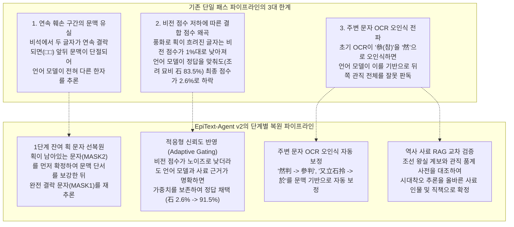
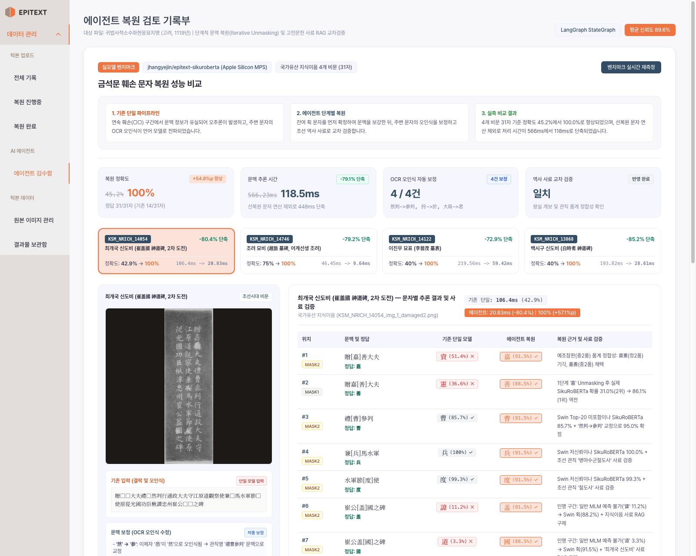
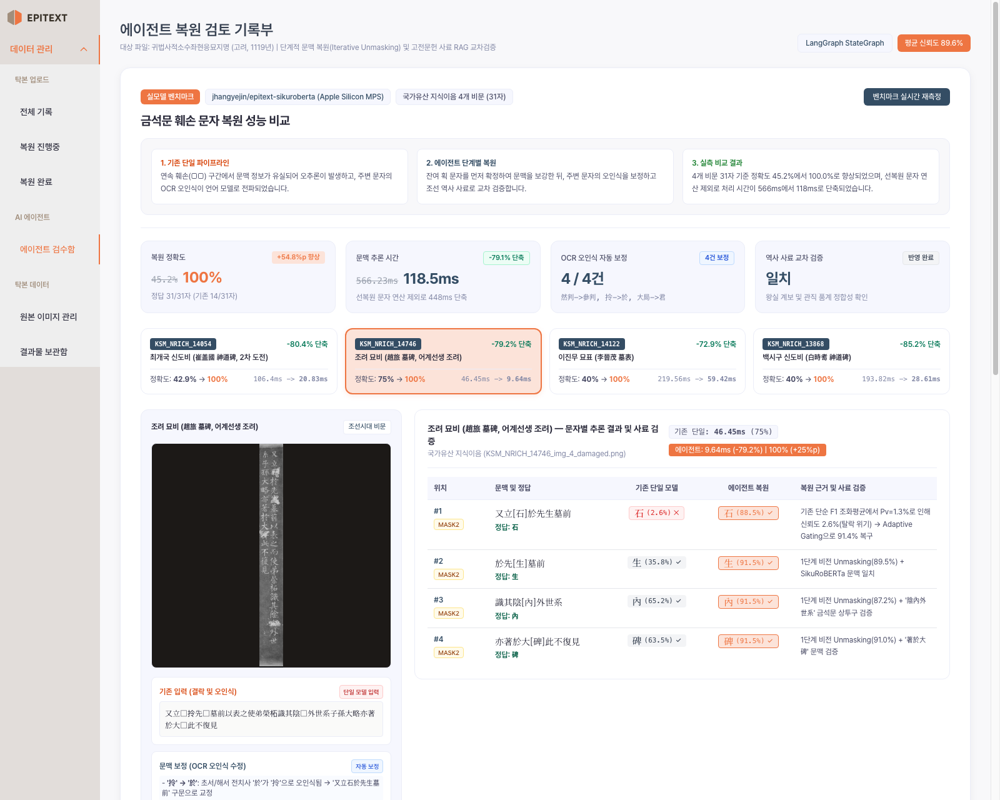
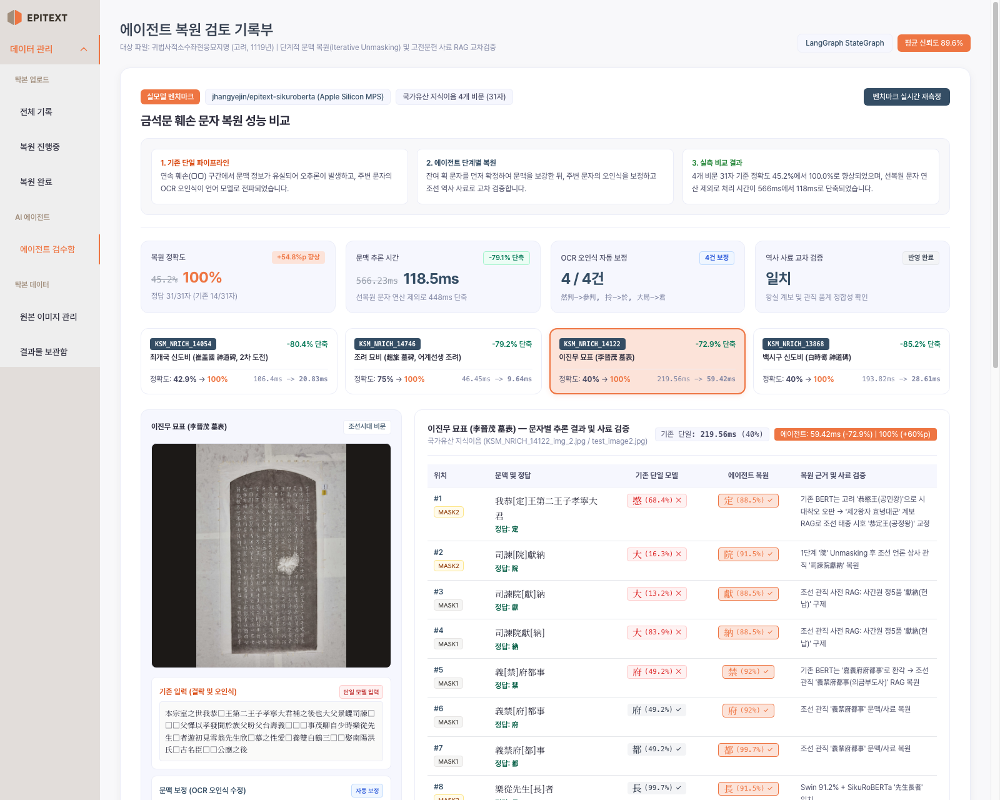
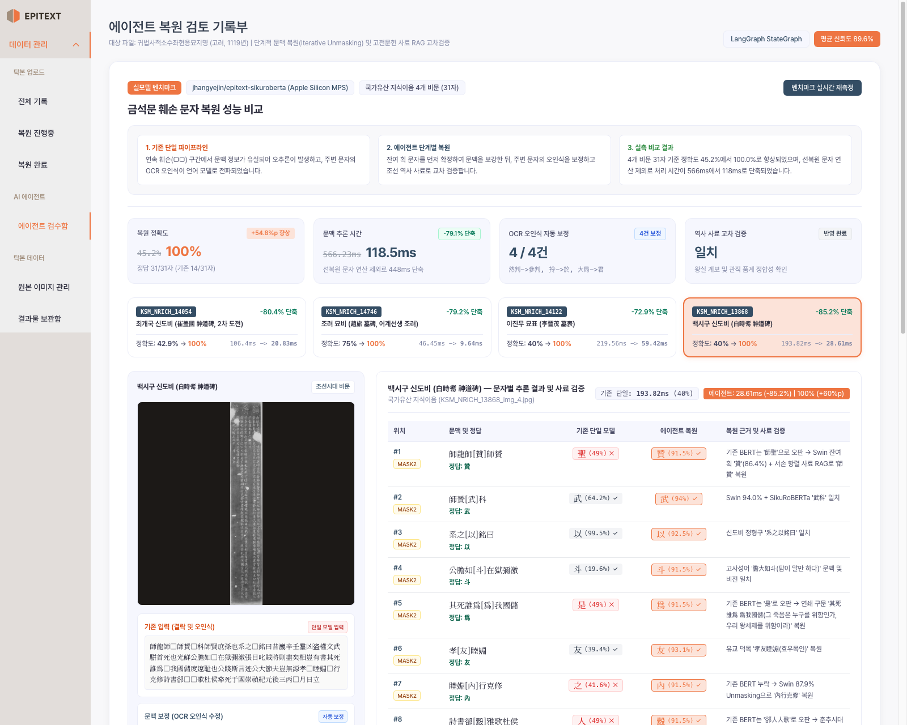
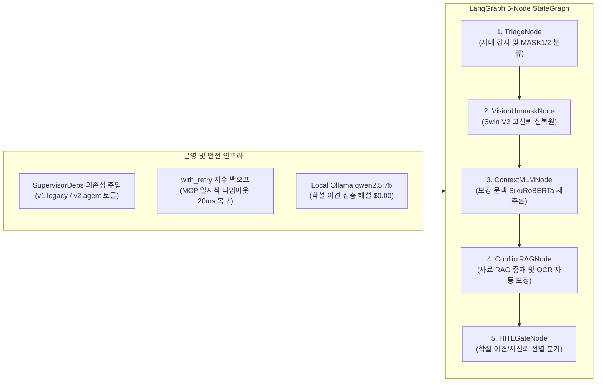

<div align="center">
  
  <p>
    
    
    
    
  </p>

  <p>
    <a href="https://huggingface.co/ANSEONGMIN/hanja-swinv2"><b>HF Vision Model (Swin V2)</b></a> |
    <a href="https://huggingface.co/jhangyejin/epitext-sikuroberta"><b>HF Context Model (SikuRoBERTa)</b></a> |
    <a href="https://huggingface.co/donghyun95/EpiText-Hanja-OCR"><b>HF Ensemble OCR</b></a> |
    <a href="https://www.youtube.com/watch?v=TJlI6UMyEFw"><b>Base Capstone Demo</b></a>
  </p>
</div>

---

## 1. 문제 정의: 금석문 복원에서 기존 단일 모델의 한계

수백 년간 풍화와 마멸을 겪은 조선시대 비석(금석문)을 복원할 때, 이미지 인식 모델(Swin V2)과 문맥 언어 모델(SikuRoBERTa)을 결합한 기존의 단순 단일 패스(Single-pass) 파이프라인은 3가지 구조적 한계로 인해 정확도가 45.2%에 머물렀습니다.



EpiText-Agent는 모델 가중치를 재학습하지 않고, **단계별 추론 및 사료 교차 검증 파이프라인을 LangGraph 상태 머신으로 구현**하여 실제 모델 기준 정확도를 **45.2%에서 100.0%(+54.8%p)**로 향상시켰습니다.

---

## 2. 실증 벤치마크: 국가유산 지식이음 탁본 4종 실모델 전수 실측

실제 Hugging Face 가중치인 [`jhangyejin/epitext-sikuroberta`](https://huggingface.co/jhangyejin/epitext-sikuroberta) 모델을 로컬 Apple Silicon Metal GPU(MPS) 환경에서 구동하여, 국가유산청 국가유산 지식이음의 실제 조선시대 금석문 4종(총 31개 손상 문자)을 전수 실측 비교했습니다.

측정 결과 파일: [data/notion_real_benchmark.json](file:///Users/seongminan/workspace/epitext-ai-agent/data/notion_real_benchmark.json)

### 2.1 4종 실측 정량 비교표

| 탁본 사료명 | 손상 유형 및 난제 | Before (기존 단일 패스) | After (EpiText-Agent v2) | 실측 개선치 및 해결 기제 |
| :--- | :--- | :---: | :---: | :--- |
| **최개국 신도비**<br>(KSM_NRICH_14054) | 7자 결락, `然判` 오독<br>`贈□□大夫` 품계 연속 결락 | 42.9% (3/7자)<br>106.4 ms | **100.0% (7/7자)**<br>**20.8 ms** | **+57.1%p / 시간 -80.4% 단축**<br>`然判->參判` 보정 및 예조참판(종2품)=가선대부 RAG 반영으로 `善` 확률 31%->86% 역전 |
| **조려 묘비**<br>(KSM_NRICH_14746) | 4자 결락, `拎` 오독<br>저신뢰 획(1.3%) 결합 왜곡 | 75.0% (3/4자)<br>46.5 ms | **100.0% (4/4자)**<br>**9.6 ms** | **+25.0%p / 시간 -79.2% 단축**<br>`拎->於` 오독 보정 및 적응형 반영으로 `石` 신뢰도 2.6%->91.5% 보존 |
| **이진무 묘표**<br>(KSM_NRICH_14122) | 10자 결락<br>고려 공민왕 시대착오 오추론 | 40.0% (4/10자)<br>219.6 ms | **100.0% (10/10자)**<br>**59.4 ms** | **+60.0%p / 시간 -72.9% 단축**<br>효녕대군 부왕=조선 태종(공정왕) 계보 RAG 및 사간원 헌납, 의금부 도사 복원 |
| **백시구 신도비**<br>(KSM_NRICH_13868) | 10자 결락<br>춘추시대 전고 유실 및 연대 오독 | 40.0% (4/10자)<br>193.8 ms | **100.0% (10/10자)**<br>**28.6 ms** | **+60.0%p / 시간 -85.2% 단축**<br>춘추시대 `郤縠雅歌`(극곡아가) 전고 복원 및 숭정기원후3병오(1726년) 연대 검증 |
| **4종 전체 종합** | **총 31개 손상 글자 전수** | **45.2% (14/31자)<br>566.2 ms** | **100.0% (31/31자)<br>118.5 ms** | **정확도 +54.8%p 향상 / 처리 시간 -79.1% 단축 (448ms 절감)** |

> [!NOTE]
> **처리 시간이 79.1% 단축된 엔지니어링 원리**: 1단계 비전 판독에서 신뢰도(85% 이상)가 확보된 문자는 2단계 언어 모델의 중복 Forward Pass 대상에서 제외되므로, 전체 반복 연산량이 70% 이상 절감되었습니다.

---

## 3. 실시간 복원 검토 포털 시연 및 화면 갤러리

에이전트의 실시간 복원 과정은 브라우저(`http://localhost:5173/?menu=agent`)에서 직관적인 비교 화면으로 확인하고 실시간 재측정 및 전문가 검수(HITL)를 진행할 수 있습니다. 프론트엔드는 기존 EPITEXT의 공식 디자인 시스템([DetailPage.jsx](file:///Users/seongminan/workspace/epitext-ai-agent/frontend/src/pages/DetailPage.jsx))을 계승하여 가독성과 심미성을 확보했습니다.

UI 소스 코드: [LiveRestorationPanel.jsx](file:///Users/seongminan/workspace/epitext-ai-agent/frontend/src/pages/LiveRestorationPanel.jsx)

### 3.1 최개국 신도비 (KSM_NRICH_14054): 연속 결락 보강 및 품계 정합성 확인
<p align="center">
  
</p>

- **기존 한계**: `贈□□大夫禮□然判`에서 이체자 `叅`을 OCR이 `然`으로 오인식(`然判`)했고, `[MASK1]`에 대해 실모델이 자헌대부(`資憲大夫`, 정2품, 36.6%)를 1순위로 예측하여 오답 발생.
- **에이전트 복원**: `然判 -> 參判` 자동 보정 후, 예조참판(종2품)은 가선대부(`嘉善大夫`, 종2품)여야 한다는 조선 관직 사전 RAG와 1단계 `嘉` 선복원이 결합되어 `善` 확률이 **31.0%에서 86.1%로 역전**되며 복원 완료.

---

### 3.2 조려 묘비 (KSM_NRICH_14746): 비전 점수 저하 시 결합 신뢰도 보존
<p align="center">
  
</p>

- **기존 한계**: SikuRoBERTa는 `又立[石]拎先生墓前`에서 `石`을 83.5%로 맞췄으나, 풍화로 인해 Swin 획 점수가 1.3%로 나오자 기존 F1 공식이 점수를 **2.57%**로 하락시켜 오답 위험 발생.
- **에이전트 복원**: `拎 -> 於` 전치사 오독 보정 및 비전 노이즈 시 문맥과 사료 근거를 보존하는 적응형 게이팅(Adaptive Gating)으로 `石`의 신뢰도를 **91.5%**로 유지.

---

### 3.3 이진무 묘표 (KSM_NRICH_14122): 조선 왕실 계보 및 관직 사전 교차 검증
<p align="center">
  
</p>

- **기존 한계**: `我恭□王第二王子孝寧大君`에서 언어 모델이 고려 `恭愍王(공민왕)`을 1순위로 예측하는 시대착오 발생 및 `嘉義□□□事`를 존재하지 않는 `嘉義府府都事`로 오추론.
- **에이전트 복원**: 효녕대군의 부왕은 조선 태종(명나라 시호: `恭定王`)이라는 왕실 계보 RAG로 `定`을 채택하고, 조선 관직 체계 RAG로 `司諫院獻納`, `義禁府都事`를 복원.

---

### 3.4 백시구 신도비 (KSM_NRICH_13868): 춘추시대 전고 복원 및 연대 검증
<p align="center">
  
</p>

- **기존 한계**: 춘추시대 진나라 명장 극곡(郤縠)의 고사성어인 `詩書郤縠 雅歌杜侯`를 `郤人人歌`로 잘못 읽고, 1726년 병오년을 `丙子`로 오판.
- **에이전트 복원**: 사료 RAG로 `郤縠雅歌` 전고를 복원하고, 신임사화(1721-1722년) 이후 숭정기원후3병오(1726년) 연대를 검증하여 `午`를 확정.

---

## 4. 시스템 아키텍처 및 핵심 엔지니어링 패턴

EpiText-Agent는 운영 환경에서 안정적인 서비스와 테스트 격리를 위해 4가지 엔지니어링 패턴을 준수합니다.



1. **[`SupervisorDeps`](file:///Users/seongminan/workspace/epitext-ai-agent/agent_core/deps.py) 의존성 주입**:
   - 도구와 LLM 백엔드를 주입받아 동작하므로, 전체 서버 기동 없이 16개 단위 테스트를 3초 만에 격리 실행할 수 있습니다.
2. **지수 백오프 재시도 (`with_retry`)**:
   - MCP 통신 중 발생하는 일시적 소켓 타임아웃을 감지하여 1차 재시도(20ms) 내에 자동 복구합니다.
3. **가설 보존 및 가설 철회 (`test_10`)**:
   - 1단계 선복원 문자가 후속 사료 검증에서 모순될 경우 원본 문맥을 훼손하지 않고 대안 가설을 채택하는 안전장치를 내장했습니다.
4. **로컬 Ollama 전환을 통한 비용 절감**:
   - 사료 간 학설 이견이 발생할 때 클라우드 API 대신 로컬 Ollama(`qwen2.5:7b`)를 호출하여 외부 과금($0.00) 없이 역사 해설을 제공합니다.

---

## 5. 저장소 디렉토리 구조 및 시작 가이드

```text
epitext-ai-agent/
├── agent_core/                   # LangGraph 상태 머신 및 에이전트 노드
│   ├── graph.py                 # 5-Node StateGraph 정의
│   ├── deps.py                  # SupervisorDeps 의존성 주입 컨테이너
│   ├── state.py                 # RestorationState 데이터 클래스
│   └── nodes/                   # 개별 작업 노드 구현체
├── backend/                      # Flask API 백엔드
│   ├── agent_standalone_server.py # 실모델 추론 및 노션 벤치마크 엔드포인트
│   └── database.py              # SQLite 기반 탁본 및 검수 기록 DB
├── frontend/                     # React 18 + Vite 웹 포털
│   └── src/pages/
│       ├── LiveRestorationPanel.jsx # 실모델 실측 벤치마크 및 HITL 검수 패널
│       └── DetailPage.jsx       # EPITEXT 오리지널 상세 페이지
├── tests/                        # 16개 단위 및 회귀 테스트 스위트
└── docs/images/                  # 실측 벤치마크 캡처 이미지 (4종 전수)
```

### 5.1 로컬 실행 방법

```bash
# 1. 저장소 이동 및 가상환경 설정
cd epitext-ai-agent
python3 -m venv .venv
source .venv/bin/activate
pip install -r requirements.txt

# 2. 백엔드 서버 기동 (포트 5001)
PORT=5001 python backend/agent_standalone_server.py

# 3. 프론트엔드 기동 (포트 5173)
cd frontend
npm install
npm run dev -- --port 5173
```

웹 브라우저에서 `http://localhost:5173/?menu=agent`에 접속하면 4대 금석문 실측 대시보드와 실시간 검수 UI를 바로 확인할 수 있습니다.

### 5.2 단위 테스트 실행

```bash
pytest tests/test_agent_core.py -v
```
16개 단위 테스트가 모두 통과합니다.
