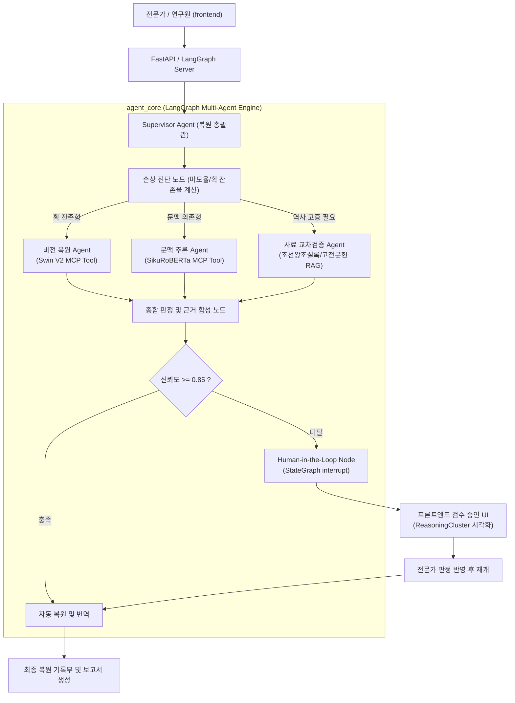

# EpiText-Agent: 훼손 금석문 탁본 복원 및 사료 교차검증 AI Agent

## 1. 프로젝트 개요

- **주제**: EpiText 복원 검토 기록부 - 훼손 금석문 탁본의 잔여 획 및 문맥 추론 기반 이상 판독 검토와 사료 교차검증 AI Agent
- **핵심 목표**: 탁본 이미지의 문자별 손상 진단 결과, 비전 잔여 획 특징 맵, 언어 모델 문맥 예측 로그를 연결하고, 고전문헌 표준과 대조해 판독 누락 및 오인식과 관련된 검토 대상을 정리. 한국고전종합DB, 조선왕조실록, 금석문 조사 보고서 등 사료 DB를 검색해 후보 한자별 용례 근거, 시대적 적합성, 추가 확인 항목을 제시하고, 한학자 및 문화재 연구원이 승인한 판독 결과를 최종 복원문과 공인 번역 보고서로 기록.
- **주요 기술**: LangGraph 기반 도구 사용 Multi-Agent (Supervisor, Vision, Context, History RAG), Swin Transformer V2 (잔여 획 분석 MCP Tool), SikuRoBERTa MLM (고문헌 문맥 추론 MCP Tool), RAG (국사편찬위원회, 규장각, 금석문 조사 보고서 벡터 및 FTS 검색), Human-in-the-Loop (HITL StateGraph interrupt 승인 루프), SSE (실시간 추론 근거 스트리밍), LangSmith (추론 트레이스 및 호출 비용 모니터링), React, FastAPI, SQLite, ChromaDB
- **주요 타깃**:
  1. 문화재청 및 박물관의 금석문 복원 연구원 (난독 문자 판독 검토 및 복원 보고서 작성)
  2. 고전번역원 및 역사학 연구자 (동시대 사료 교차검증 및 문헌학적 용례 분석)
  3. 문화유산 디지털 아카이브 관리자 (복원 이력 영속화 및 메타데이터 정합성 검증)
- **최종 서비스**: 사내 포털형 웹 화면 - 탁본 이미지 업로드, 문자별 획 인식 및 검사 이력, 난독 문자 이상 검토함, D3 기반 ReasoningCluster 근거 분석 대화, 전문가 최종 판정 승인 및 복원 기록부, 복원 진행 현황 대시보드, 최종 판독 및 번역 보고서 출력 (PDF, Markdown)

---

## 2. 시스템 아키텍처



---

## 3. 디렉토리 구조

```
epitext-ai-agent/
├── backend/              # Flask/FastAPI 백엔드 소스 (jincerity/Epitext_back 기반)
├── frontend/             # React Vite D3 프론트엔드 소스 (jincerity/Epitext_front 기반)
├── agent_core/           # LangGraph StateGraph, FastMCP, HITL 구현
├── data/                 # 금석문 사료 DB 및 샘플 탁본 이미지
├── .gitignore            # Git 제외 설정
└── README.md             # 프로젝트 명세서
```
