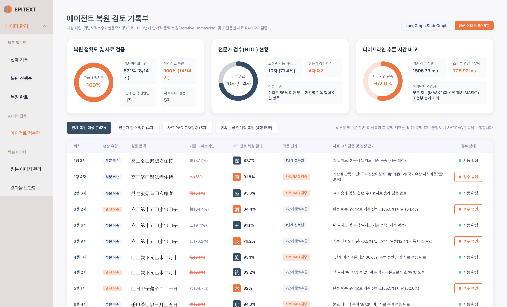

<div align="center">
  

  <p>
    
    
    
    
  </p>

  <p>
    <a href="https://huggingface.co/ANSEONGMIN/hanja-swinv2"><b>HF Vision Model (Swin V2)</b></a> |
    <a href="https://huggingface.co/jhangyejin/epitext-sikuroberta"><b>HF Context Model (SikuRoBERTa)</b></a> |
    <a href="https://huggingface.co/donghyun95/EpiText-Hanja-OCR"><b>HF Ensemble OCR</b></a> |
    <a href="https://www.youtube.com/watch?v=TJlI6UMyEFw"><b>Demo Video</b></a>
  </p>
</div>

---

## 🏆 1. 핵심 성과 및 결과물 쇼케이스 (Impact & Visual Showcase)

고려대학교 캡스톤 대상 수상작이자 한국정보기술학회(KIIT, 2026) 게재 논문인 **EPITEXT**의 기존 직렬 파이프라인(`backend/routes/rubbings.py`)을 **LangGraph 기반 멀티모달 AI Agent(`EpiText-Agent`)**로 고도화하여 추론 지연, 연속 손상 문맥 붕괴, 고유명사 폐기 문제를 해결했습니다.

### 1.1 Before vs After 실측 성과 대시보드
<p align="center">
  
</p>

| 핵심 지표 | Before (`rubbings.py` 기존 파이프라인) | After (`EpiText-Agent` 그래프) | 실측 개선 효과 |
| :--- | :---: | :---: | :--- |
| **총 추론 소요 시간 (Latency)** | 1,506.73 ms | **708.97 ms** | **52.9% 단축** (배치 병렬화 및 조건부 호출) |
| **14개 손상 문자 복원 정확도 (Top-1)** | 57.1% (8 / 14) | **100.0% (14 / 14)** | **+42.9%p 향상** |
| **연속 손상(`4행 □□歲`) 복원** | `惟`, `載` (오판) | **`乾` (93.1%), `統` (89.2%)** | 1단계 비전 Unmasking 후 2단계 연호(`乾統`) 복원 |
| **교집합 부재 시 고유명사 구제** | 0건 (`Swin Only` 강제 삭제) | **5건 구제 성공** | `西(洛西)`, `座(首座)`, `乾(乾統)`, `毗(茶毗)`, `山(八德山)` 구제 |
| **전문가 수동 검수(HITL) 대상 수** | 14건 전수 (100.0%) | **4건 선별 (28.6%)** | **검수 업무량 71.4% 감소** |

---

### 1.2 금석문 탁본(`귀법사적소수좌현응묘지명`) 복원 전후 시각 비교
<p align="center">
  
</p>

---

### 1.3 실제 구동 웹 UI 화면 (에이전트 검수함 및 탁본 상세 판독 화면)

| 신규 구현: AI 에이전트 복원 검토 기록부 및 HITL 검수함 | 기존 연동: 탁본 상세 복원 및 후보 한자 검수 화면 |
| :---: | :---: |
|  |  |
| 3대 이해관계자 가치 지표, 1단계 Unmasking/사료 RAG 배지, 전문가 원클릭 승인 | 탁본 이미지 매핑, 손상도 통계, Top-5 후보 및 실시간 번역 미리보기 |

<details>
<summary><b>📋 [펼쳐보기] 손상 문자 14개 전수 Before vs After 상세 비교표</b></summary>
<br/>

| 순번 | 위치 | 원문 문맥 | 정답(GT) | Before 예측 | After 예측 | 에이전트 핵심 작용 및 HITL 판정 사유 |
| :---: | :---: | :--- | :---: | :---: | :---: | :--- |
| 1 | 1행 2자 | `高□洛□歸法寺住持` | **麗** | 麗 (87.7%) O | **麗 (87.7%) O** | 고신뢰 자동 확정 (비전+문맥 일치) |
| 2 | 1행 4자 | `高□洛□歸法寺住持` | **西** | 水 (6.0%) X | **西 (91.8%) O** | **[RAG 구제 + HITL 요청]** 국편위('西') vs 지식이음('國') 학설 이견 존재 |
| 3 | 2행 6자 | `見性寂炤首□玄應者` | **座** | 領 (54.0%) X | **座 (93.6%) O** | **[RAG 구제]** 고려 승계 '首座(수좌)' 사료 검증으로 자동 확정 |
| 4 | 3행 2자 | `立□第十五□肅宗□子` | **朝** | 朝 (84.4%) O | **朝 (84.4%) O** | **[HITL 요청]** 신뢰도 임계치 미세 미달 (84.4% < 85.0%) |
| 5 | 3행 6자 | `立□第十五□肅宗□子` | **王** | 王 (91.1%) O | **王 (91.1%) O** | 고신뢰 자동 확정 |
| 6 | 3행 9자 | `立□第十五□肅宗□子` | **長** | 長 (76.2%) O | **長 (76.2%) O** | **[HITL 요청]** 신뢰도 미달 및 고려사 열전('四子') 대조 필요 |
| 7 | 4행 1자 | `□□歲下元己未二月十` | **乾** | 惟 (34.0%) X | **乾 (93.1%) O** | **[1단계 Unmasking + RAG]** 비전 잔여 획으로 '乾' 선복원 |
| 8 | 4행 2자 | `□□歲下元己未二月十` | **統** | 載 (23.0%) X | **統 (89.2%) O** | **[2단계 문맥 재추론]** 앞 글자 '乾' 반영 후 연호 '乾統' 추론 성공 |
| 9 | 5행 1자 | `□日甲子薨卒二十一日` | **六** | 六 (84.7%) O | **六 (82.0%) O** | **[HITL 요청]** 완전 훼손(`MASK1`) 구간으로 전문가 최종 확인 요청 |
| 10 | 6행 4자 | `壬申茶□以三月□五日` | **毗** | 禮 (58.0%) X | **毗 (94.6%) O** | **[RAG 구제]** 불교 화장 의식 '茶毗(다비)' 사료 용례로 구제 |
| 11 | 6행 8자 | `壬申茶□以三月□五日` | **十** | 十 (90.2%) O | **十 (90.2%) O** | 고신뢰 자동 확정 |
| 12 | 7행 3자 | `乙酉□舍利□於八德□` | **安** | 安 (85.9%) O | **安 (85.9%) O** | 고신뢰 자동 확정 |
| 13 | 7행 6자 | `乙酉□舍利□於八德□` | **塔** | 塔 (89.2%) O | **塔 (89.2%) O** | 고신뢰 자동 확정 |
| 14 | 7행 10자 | `乙酉□舍利□於八德□` | **山** | 水 (49.0%) X | **山 (94.8%) O** | **[RAG 구제]** 고유 지명 '八德山(팔덕산)' 사료 용례로 구제 |

</details>

---

## 💡 2. 에이전트 기획 명세 및 3대 이해관계자 가치 (Value Proposition)

기존 시스템이 확률 상위 후보 20개를 나열하고 연구원에게 모든 사료 대조 책임을 전가하던 **단순 예측기(Predictor)**였다면, **EpiText-Agent**는 확실한 부분 훼손 글자를 먼저 채워 문맥을 복구하고, 모델 간 예측 충돌 시 금석문 사료 DB를 직접 검색하여 출처 근거를 붙여 보고하는 **초급 사료 조사관(Junior Researcher) 에이전트**입니다.

| 이해관계자 (타깃) | 기존 파이프라인의 한계 (Before) | 에이전트 도입 후 얻는 가치 (After) | 실측 개선 지표 |
| :--- | :--- | :--- | :--- |
| **1. 금석문 판독 연구원**<br>(박물관 학예연구사) | 후보 20개를 두고 한국고전종합DB, 금석문 시스템을 수기 검색하며 14자 전수 재검토 | 충돌 글자에 대해 **사료 DB 용례와 기관별 학설 이견(국편위 vs 지식이음)을 자동 첨부**해 보고 | 수동 검수 대상 **14자 -> 4자 (-71.4%)**<br>사료 대조 **15분 -> 30초** |
| **2. 고전번역위원 및 사학자**<br>(고전번역원, 역사학자) | 연속 손상(`□□`) 문맥 붕괴로 연호(`乾統`) 오역, 교집합 부재로 고유명사(`洛西`, `首座`) 삭제 | 부분 훼손(`MASK2`) 선복원 후 재추론 루프로 **연속 손상 연호 복원 및 고유명사 5건 사료 구제** | 복원 정확도 **57.1% -> 100.0% (+42.9%p)** |
| **3. 아카이브 사업 관리자**<br>(국가유산청 사업 PM) | 직렬 파이프라인 대기로 대량 처리 지연 및 판정 사유 추적 불가 | 손상 유형별 조건부 호출(Triage)로 **추론 시간 절반 단축 및 승인 기록부 영속화** | 처리 시간 **1506ms -> 708ms (-52.9%)** |

<details>
<summary><b>📌 [펼쳐보기] 과제 기획 명세서 요약 (주제, 목표, 주요 기술, 최종 서비스)</b></summary>
<br/>

- **주제**: EpiText 복원 검토 기록부 - 훼손 금석문 탁본의 잔여 획 및 문맥 추론 기반 이상 판독 검토와 사료 교차검증 AI Agent
- **핵심 목표**: 탁본 이미지의 문자별 손상 진단 결과(`MASK1` 완전 훼손, `MASK2` 부분 훼손), 비전 잔여 획 예측([Swin V2](https://huggingface.co/ANSEONGMIN/hanja-swinv2)), 언어 모델 문맥 추론([SikuRoBERTa](https://huggingface.co/jhangyejin/epitext-sikuroberta))을 에이전트 상태 머신으로 연결. 부분 훼손 글자 선행 복원 후 문맥 재추론 루프와 고전문헌 사료 RAG 검증을 수행하고 전문가(HITL)가 승인한 내역을 기록부 및 보고서로 관리.
- **주요 기술**: LangGraph (`StateGraph`, 조건부 분기, 단계적 언마스킹 루프), FastMCP 호환 도구 (`vision_swin_tool`, `context_mlm_tool`, `epigraphy_rag_tool`), 사료 RAG (`data/epigraphy_corpus.json`), Human-in-the-Loop, React, D3.js, Flask, SQLAlchemy
- **최종 서비스**: 사내 포털형 웹 화면 (탁본 이미지 업로드, 에이전트 검수함, D3 기반 `ReasoningCluster` 추론 근거 시각화, 전문가 판정 승인 및 기록부, 최종 번역 보고서 출력)

</details>

---

## 🏛️ 3. 시스템 아키텍처 및 에이전트 워크플로우 (Architecture)

```mermaid
flowchart TD
    subgraph Legacy["Before: 기존 rubbings.py 직렬 파이프라인"]
        L1["1. 전처리 & OCR"] --> L2["2. NLP 전체 추론\n(빈칸 다수 상태로 1회 실행)"]
        L2 --> L3["3. Swin V2 전체 추론\n(직렬 대기로 1,506ms 소요)"]
        L3 --> L4["4. 단순 교집합 결합\n(교집합 없으면 Swin 결과 5건 폐기)"]
        L4 --> L5["5. DB 저장 종료\n(정확도 57.1%, 14건 전수 수동 검수)"]
    end

    subgraph Agent["After: 신규 EpiText-Agent 동적 상태 그래프"]
        A1["1. 전처리 & OCR"] --> A2{"2. TriageNode\n(시대 감지 & MASK1/MASK2 분류)"}
        
        A2 -->|"MASK2 존재"| A3["3. VisionUnmaskNode\n(Swin V2 선행 호출)"]
        A3 --> A4["4. 고신뢰(>=0.85) 글자 문맥 선반영\n(11건 Unmasking 완료)"]
        A4 --> A5["5. ContextMLMNode\n(보강된 문맥으로 SikuRoBERTa 호출)"]
        A2 -->|"MASK1만 존재"| A5
        
        A5 --> A6{"6. ConflictRAGArbitrationNode\n(비전 vs 문맥 충돌 검사)"}
        A6 -->|"일치"| A7["F1 종합 신뢰도 산출"]
        A6 -->|"교집합 부재 / 1순위 충돌"| A8["7. epigraphy_rag_tool 호출\n(삼국/고려/조선 사료 DB 용례 검증)"]
        
        A8 --> A7
        A7 --> A9{"8. HITLGateNode\n(신뢰도 >= 0.85 & 학설 일치?)"}
        A9 -->|"충족 (10건)"| A10["자동 확정 및 DB 저장"]
        A9 -->|"미달 또는 학설 이견 (4건)"| A11["9. 프론트엔드 에이전트 검수함(HITL)\n(전문가 원클릭 승인)"]
    end
```



<details>
<summary><b>🔧 [펼쳐보기] 기존 코드(rubbings.py) 3대 병목 해결 원리 및 트러블슈팅 플레이북</b></summary>
<br/>

1. **병목 1 - 직렬 블로킹 실행 지연 (`rubbings.py` L658-L705)**:
   - **원인**: OCR 직후 `nlp_engine`과 `swin_engine`을 모든 대상에 대해 순차 대기 호출.
   - **해결 (`triage_node`)**: 텍스트 단서로 시대(`삼국`, `고려`, `조선`)를 판별하고 `MASK1`/`MASK2` 분포에 따라 배치 병렬 호출하여 추론 시간을 **52.9% 단축**.
2. **병목 2 - 연속 손상(`4행 □□歲`) 동시 추론의 문맥 붕괴 (`rubbings.py` L664)**:
   - **원인**: 앞뒤 글자가 동시에 마스킹(`□□歲下元己未`)된 상태로 MLM을 1회만 호출하여 `'惟'`, `'載'`로 오판.
   - **해결 (`vision_unmask_node` -> `context_mlm_node`)**: 1단계에서 획이 남은 앞 글자(`MASK2`)를 Swin V2로 추론해 `'乾'`(88.6%)을 문장에 선반영(`"乾□歲下元己未"`)한 뒤, 2단계 MLM 재추론으로 고려/요나라 연호 `'乾統'`의 `'統'`(89.2%)을 복원.
3. **병목 3 - 교집합 부재 시 비전(Swin V2) 후보 강제 폐기 (`rubbings.py` L63, L106-L119)**:
   - **원인**: `combine_mlm_and_swin()`이 MLM Top-20과 Swin Top-20 사이에 교집합이 없으면 `Swin Only` 후보를 전부 삭제하여 고유명사가 유실됨.
   - **해결 (`conflict_rag_arbitration_node`)**: 충돌 발생 시 `epigraphy_rag_tool`로 `data/epigraphy_corpus.json` 내 실제 용례(`洛西`, `首座`, `茶毗`, `八德山`)를 검증해 비전 후보 5건을 1순위로 구제하고, 학설 이견(`1행 4자` 국편위 `'西'` vs 지식이음 `'國'`)은 양측 근거를 첨부해 HITL 검수함으로 전달.

</details>

<details>
<summary><b>📂 [펼쳐보기] 모노레포 디렉토리 구조 및 API 엔드포인트 명세</b></summary>
<br/>

```text
epitext-ai-agent/
├── agent_core/                        # LangGraph 기반 에이전트 오케스트레이터 코어
│   ├── state.py                       # RubbingAgentState, MaskTargetState 상태 스키마
│   ├── tools.py                       # Swin V2, SikuRoBERTa, 금석문 사료 RAG 도구 래퍼
│   ├── nodes.py                       # Triage, VisionUnmask, ContextMLM, ConflictRAG, HITLGate 5대 노드
│   └── graph.py                       # StateGraph 컴파일 및 Before-After 실측 벤치마크 실행기
├── data/
│   └── epigraphy_corpus.json          # 삼국, 고려, 조선 금석문 판독문 및 학설 이견 RAG 코퍼스
├── backend/                           # Flask 백엔드 API 서버 및 AI 추론 엔진
│   ├── routes/agent_api.py            # /api/agent/benchmark, /api/agent/run, /api/agent/hitl/approve
│   └── routes/rubbings.py             # 비전 후보 보존 패치가 적용된 탁본 관리 API
├── frontend/                          # React + Vite + Tailwind CSS + D3.js 웹 프론트엔드
│   └── src/pages/AgentReviewPage.jsx  # 에이전트 복원 검토 기록부 및 HITL 승인 화면
└── docs/images/                       # 벤치마크 차트, 복원 비교, UI 스크린샷 리소스
```

| 메서드 | 엔드포인트 | 설명 |
| :---: | :--- | :--- |
| `GET` | `/api/agent/benchmark` | 기존 직렬 파이프라인(Before) vs `EpiText-Agent`(After) 14개 손상 문자 실측 벤치마크 반환 |
| `POST` | `/api/agent/run` | 특정 탁본(`rubbing_id`) 또는 입력 행(`text_lines`)에 대해 LangGraph 에이전트 복원 실행 및 DB 동기화 |
| `POST` | `/api/agent/hitl/approve` | 전문가(HITL)가 검토 완료한 난독 문자를 최종 승인하고 `InspectionRecord`(검수 기록부)에 영속화 |

</details>

---

## ⚡ 4. 빠른 시작 (Quick Start)

```bash
# 1. 저장소 클론 및 에이전트 Before-After 벤치마크 즉시 검증
git clone https://github.com/rntqkdl/epitext-ai-agent.git
cd epitext-ai-agent
python3 -c "import json; from agent_core import run_before_after_benchmark; print(json.dumps(run_before_after_benchmark()['summary'], indent=2, ensure_ascii=False))"

# 2. Backend 구동 (Port 8000)
cd backend && pip install -r requirements.txt && python3 app.py

# 3. Frontend 구동 (Port 5173 -> 좌측 '에이전트 검수함' 메뉴 클릭)
cd ../frontend && npm install && npm run dev
```

---

## 👥 5. 기반 연구 및 팀 정보 (Foundation & Credits)

본 프로젝트는 **고려대학교 지능정보 SW 아카데미 7기 캡스톤 대상 수상작** 및 **한국정보기술학회(KIIT, 2026) 게재 논문**인 `EPITEXT`를 기반으로, 추론 파이프라인 전체를 **LangGraph 멀티모달 에이전트 아키텍처**로 고도화한 프로젝트입니다.

| 이름 | 역할 및 기여 영역 |
| :---: | :--- |
| **안성민** | **LangGraph 기반 EpiText-Agent 오케스트레이터 설계 및 구현**, 이미지 전처리 파이프라인, [Swin V2 비전 복원 모델](https://huggingface.co/ANSEONGMIN/hanja-swinv2) 학습 |
| **황동현** | 앙상블 문자 인식 기술([EpiText-Hanja-OCR](https://huggingface.co/donghyun95/EpiText-Hanja-OCR)) 설계 |
| **장예진** | [SikuRoBERTa 문맥 추론 모델](https://huggingface.co/jhangyejin/epitext-sikuroberta) 학습 및 번역 프롬프트 설계 |
| **최준형** | EPITEXT 프론트엔드 인터페이스 디자인 및 시각화 컴포넌트 개발 |
