<div align="center">
  

  <p>
    
    
    
    
  </p>

  <p>
    <a href="https://huggingface.co/ANSEONGMIN/hanja-swinv2"><b>HF Vision Model (Swin V2)</b></a> |
    <a href="https://huggingface.co/jhangyejin/epitext-sikuroberta"><b>HF Context Model (SikuRoBERTa)</b></a> |
    <a href="https://huggingface.co/donghyun95/EpiText-Hanja-OCR"><b>HF Ensemble OCR</b></a> |
    <a href="https://www.youtube.com/watch?v=TJlI6UMyEFw"><b>Demo Video</b></a>
  </p>
</div>

---

## 1. 핵심 성과 및 결과물 쇼케이스 (Performance & Visual Showcase)

고려대학교 캡스톤 대상 수상작 및 한국정보기술학회(KIIT, 2026) 게재 논문인 **EPITEXT**의 멀티모달 복원 파이프라인(`backend/routes/rubbings.py`)을 **LangGraph 상태 머신(`EpiText-Agent`)**으로 확장하여, 손상 유형별 조건부 라우팅, 단계적 문맥 복원(Iterative Unmasking), 고전문헌 사료 RAG 교차검증 및 전문가 검수(HITL) 워크플로우를 구축했습니다.

### 1.1 기존 단일 패스 파이프라인(Before) vs 에이전트 워크플로우(After) 실측 비교
<p align="center">
  
</p>

| 핵심 지표 | Before (`rubbings.py` 단일 패스) | After (`EpiText-Agent` 워크플로우) | 실측 개선 효과 |
| :--- | :---: | :---: | :--- |
| **파이프라인 추론 시간** | 1,506.73 ms | **708.97 ms** | **52.9% 단축** (손상 유형별 조건부 분기 및 배치 병렬화) |
| **14개 손상 문자 복원 일치율** | 57.1% (8 / 14자) | **100.0% (14 / 14자)** | **+42.9%p 향상** |
| **연속 손상(`4행 □□歲`) 복원** | `惟`, `載` | **`乾` (93.1%), `統` (89.2%)** | 1단계 비전 추론(`乾`) 선반영 후 2단계 문맥 재추론(`乾統`) |
| **사료 RAG 기반 고유명사 검증** | 교집합 우선 병합 | **5자 사료 검증 완료** | `西(洛西)`, `座(首座)`, `乾(乾統)`, `毗(茶毗)`, `山(八德山)` 검증 |
| **전문가 검수(HITL) 대상 수** | 14자 전체 검토 | **4자 선별 검토 (28.6%)** | 고신뢰 10자 자동 확정, 학설 이견 및 저신뢰 4자 선별 (**-71.4%**) |

---

### 1.2 금석문 탁본(`귀법사적소수좌현응묘지명`) 주요 손상 구간 복원 비교
<p align="center">
  
</p>

---

### 1.3 웹 포털 UI 화면 (에이전트 복원 검토 기록부 및 탁본 상세 검수)

| 에이전트 복원 검토 기록부 (`AgentReviewPage.jsx`) | 탁본 상세 복원 및 후보 한자 검수 (`DetailPage.jsx`) |
| :---: | :---: |
|  |  |
| 복원 정확도, HITL 검수 현황, 추론 시간 비교 도넛 차트 및 사료 검증 내역 | 탁본 원본 정보, 복원 대상 분포, Top-5 추천 한자 및 번역 미리보기 |

<details>
<summary><b>[펼쳐보기] 복원 대상 14자 전수 Before vs After 상세 비교표</b></summary>
<br/>

| 순번 | 위치 | 손상 유형 | 원문 문맥 | 정답 | 기존 파이프라인 | 에이전트 복원 | 적용 단계 및 사료 교차검증 내역 |
| :---: | :---: | :---: | :--- | :---: | :---: | :---: | :--- |
| 1 | 1행 2자 | 부분 훼손 | `高□洛□歸法寺住持` | **麗** | 麗 (87.7%) | **麗 (87.7%)** | 획 일치도 및 문맥 일치도 기준 충족 (자동 확정) |
| 2 | 1행 4자 | 부분 훼손 | `高□洛□歸法寺住持` | **西** | 水 (6.0%) | **西 (91.8%)** | **[사료 RAG + 검수 분리]** 국편위('西', 洛西) vs 지식이음('國', 洛國) 학설 병기 |
| 3 | 2행 6자 | 부분 훼손 | `見性寂炤首□玄應者` | **座** | 領 (54.0%) | **座 (93.6%)** | **[사료 RAG 검증]** 고려 승계 명칭 '首座(수좌)' 사료 용례 확인 |
| 4 | 3행 2자 | 완전 훼손 | `立□第十五□肅宗□子` | **朝** | 朝 (84.4%) | **朝 (84.4%)** | **[전문가 검수]** 완전 훼손 구간으로 기준 신뢰도(85.0%) 미달 (84.4%) |
| 5 | 3행 6자 | 부분 훼손 | `立□第十五□肅宗□子` | **王** | 王 (91.1%) | **王 (91.1%)** | 획 일치도 및 문맥 일치도 기준 충족 (자동 확정) |
| 6 | 3행 9자 | 부분 훼손 | `立□第十五□肅宗□子` | **長** | 長 (76.2%) | **長 (76.2%)** | **[전문가 검수]** 기준 신뢰도 미달(76.2%) 및 고려사 열전('四子') 대조 필요 |
| 7 | 4행 1자 | 부분 훼손 | `□□歲下元己未二月十` | **乾** | 惟 (34.0%) | **乾 (93.1%)** | **[1단계 선복원 + RAG]** 비전 잔여 획 추론('乾', 88.6%) 문맥 선반영 |
| 8 | 4행 2자 | 완전 훼손 | `□□歲下元己未二月十` | **統** | 載 (23.0%) | **統 (89.2%)** | **[2단계 문맥 재추론]** 앞 글자 '乾' 반영 후 연호 '乾統' 도출 |
| 9 | 5행 1자 | 완전 훼손 | `□日甲子薨卒二十一日` | **六** | 六 (84.7%) | **六 (82.0%)** | **[전문가 검수]** 완전 훼손 구간으로 기준 신뢰도(85.0%) 미달 (82.0%) |
| 10 | 6행 4자 | 부분 훼손 | `壬申茶□以三月□五日` | **毗** | 禮 (58.0%) | **毗 (94.6%)** | **[사료 RAG 검증]** 불교 다비식 용어 '茶毗(다비)' 사료 용례 확인 |
| 11 | 6행 8자 | 부분 훼손 | `壬申茶□以三月□五日` | **十** | 十 (90.2%) | **十 (90.2%)** | 획 일치도 및 문맥 일치도 기준 충족 (자동 확정) |
| 12 | 7행 3자 | 부분 훼손 | `乙酉□舍利□於八德□` | **安** | 安 (85.9%) | **安 (85.9%)** | 획 일치도 및 문맥 일치도 기준 충족 (자동 확정) |
| 13 | 7행 6자 | 부분 훼손 | `乙酉□舍利□於八德□` | **塔** | 塔 (89.2%) | **塔 (89.2%)** | 획 일치도 및 문맥 일치도 기준 충족 (자동 확정) |
| 14 | 7행 10자 | 부분 훼손 | `乙酉□舍利□於八德□` | **山** | 水 (49.0%) | **山 (94.8%)** | **[사료 RAG 검증]** 고유 지명 '八德山(팔덕산)' 사료 용례 확인 |

</details>

---

## 2. 에이전트 설계 목적 및 이해관계자별 제공 가치 (Stakeholder Value)

기존 멀티모달 복원 엔진(Swin V2, SikuRoBERTa)의 추론 결과를 상태 기반 그래프(StateGraph)로 연결하여, 부분 훼손 문자의 선행 복원 결과를 주변 문맥에 반영하고 고전문헌 사료 코퍼스 대조를 자동화함으로써 이해관계자별 실무 효율을 높였습니다.

| 이해관계자 (타깃) | 기존 단일 패스 방식 (Before) | 에이전트 워크플로우 확장 (After) | 실측 개선 지표 |
| :--- | :--- | :--- | :--- |
| **1. 금석문 판독 연구원**<br>(박물관 학예연구사) | 추천 후보군을 바탕으로 외부 고전 DB에서 용례를 직접 대조하며 14자 전체를 순차 검토 | 비전-문맥 후보 불일치 구간에 대해 **사료 코퍼스 용례와 기관별 판독 학설 이견을 자동 조회**하여 제시 | 검토 대상 **14자 -> 4자 (-71.4%)**<br>사료 대조 시간 단축 |
| **2. 고전번역위원 및 사학자**<br>(고전번역원, 역사학자) | 연속 손상(`□□`) 구간에서 문맥 단서가 부족하거나, 고유명사가 교집합 조건에서 제외됨 | 부분 훼손(`MASK2`) 선복원 후 재추론 루프로 **연속 손상 연호(`乾統`) 및 고유명사 5자 복원** | 복원 일치율 **57.1% -> 100.0% (+42.9%p)** |
| **3. 아카이브 사업 관리자**<br>(국가유산청 사업 PM) | 전체 대상에 대해 NLP와 비전 엔진을 직렬 실행하여 대량 처리 시 대기 시간 증가 | 손상 유형별 조건부 호출(Triage) 및 배치 병렬화로 **추론 소요 시간 단축 및 검수 기록부 DB 관리** | 처리 시간 **1506.7ms -> 708.9ms (-52.9%)** |

<details>
<summary><b>[펼쳐보기] 프로젝트 기획 명세서 (주제, 목표, 주요 기술, 최종 서비스)</b></summary>
<br/>

- **주제**: EpiText 복원 검토 기록부 - 훼손 금석문 탁본의 잔여 획 및 문맥 추론 기반 이상 판독 검토와 사료 교차검증 AI Agent
- **핵심 목표**: 탁본 이미지의 문자별 손상 진단 결과(`MASK1` 완전 훼손, `MASK2` 부분 훼손), 비전 잔여 획 예측([Swin V2](https://huggingface.co/ANSEONGMIN/hanja-swinv2)), 언어 모델 문맥 추론([SikuRoBERTa](https://huggingface.co/jhangyejin/epitext-sikuroberta))을 에이전트 상태 머신으로 연결. 부분 훼손 글자 선행 복원 후 문맥 재추론 루프와 고전문헌 사료 RAG 검증을 수행하고 전문가(HITL)가 승인한 내역을 기록부 및 보고서로 관리.
- **주요 기술**: LangGraph (`StateGraph`, 조건부 분기, 단계적 문맥 복원 루프), FastMCP 호환 도구 (`vision_swin_tool`, `context_mlm_tool`, `epigraphy_rag_tool`), 사료 RAG (`data/epigraphy_corpus.json`), Human-in-the-Loop, React, D3.js, Flask, SQLAlchemy
- **최종 서비스**: 웹 포털 화면 (탁본 이미지 업로드, 에이전트 복원 검토 기록부, D3 기반 `ReasoningCluster` 추론 근거 시각화, 전문가 검수 승인 및 실시간 번역 보고서 출력)

</details>

---

## 3. 시스템 아키텍처 및 에이전트 워크플로우 (System Architecture)

```mermaid
flowchart TD
    subgraph Legacy["Before: 기존 rubbings.py 단일 패스 파이프라인"]
        L1["1. 전처리 및 OCR"] --> L2["2. NLP 전체 추론\n(마스킹 상태에서 1회 실행)"]
        L2 --> L3["3. Swin V2 전체 추론\n(직렬 실행, 1,506ms 소요)"]
        L3 --> L4["4. 교집합 우선 후보 결합\n(교집합 부재 시 비전 단독 후보 미반영)"]
        L4 --> L5["5. DB 저장 및 전체 수동 검수\n(일치율 57.1%, 14자 전체 검토)"]
    end

    subgraph Agent["After: EpiText-Agent 동적 상태 그래프"]
        A1["1. 전처리 및 OCR"] --> A2{"2. TriageNode\n(시대 판별 및 손상 유형 분류)"}
        
        A2 -->|"부분 훼손(MASK2) 포함"| A3["3. VisionUnmaskNode\n(Swin V2 선행 추론)"]
        A3 --> A4["4. 고신뢰(>=85%) 문자 문맥 선반영\n(11자 Unmasking 적용)"]
        A4 --> A5["5. ContextMLMNode\n(보강된 문맥으로 SikuRoBERTa 추론)"]
        A2 -->|"완전 훼손(MASK1)만 존재"| A5
        
        A5 --> A6{"6. ConflictRAGArbitrationNode\n(비전-문맥 후보 일치 여부 확인)"}
        A6 -->|"후보 일치"| A7["F1 종합 신뢰도 산출"]
        A6 -->|"교집합 부재 또는 1순위 상이"| A8["7. epigraphy_rag_tool 호출\n(삼국/고려/조선 금석문 코퍼스 대조)"]
        
        A8 --> A7
        A7 --> A9{"8. HITLGateNode\n(신뢰도 >= 85% 및 학설 단일 여부)"}
        A9 -->|"기준 충족 (10자)"| A10["자동 확정 및 DB 저장"]
        A9 -->|"신뢰도 미달 또는 학설 이견 (4자)"| A11["9. 에이전트 복원 검토 기록부(HITL)\n(전문가 검수 승인)"]
    end
```



<details>
<summary><b>[펼쳐보기] 파이프라인 고도화 상세 원리 (코드 레벨 변경점)</b></summary>
<br/>

1. **조건부 라우팅 및 배치 병렬화 (`agent_core/nodes.py` - `triage_node`)**:
   - **기존 동작 (`rubbings.py` L658-L705)**: OCR 직후 모든 대상에 대해 NLP 엔진과 비전 엔진을 순차 호출.
   - **고도화 내용**: 텍스트 내 단서로 시대(`삼국`, `고려`, `조선`)를 판별하고 `MASK1`/`MASK2` 분포에 따라 필요한 추론 도구를 배치 단위로 실행하여 소요 시간을 **52.9% 단축**.
2. **단계적 문맥 복원 루프 (`vision_unmask_node` -> `context_mlm_node`)**:
   - **기존 동작 (`rubbings.py` L664)**: 4행 `"□□歲下元己未二月十"`과 같은 연속 손상 구간을 동시에 마스킹한 상태로 1회 추론.
   - **고도화 내용**: 1단계에서 잔여 획이 존재하는 앞 글자(`MASK2`)를 Swin V2로 추론해 `'乾'`(88.6%)을 문맥에 먼저 대입(`"乾□歲下元己未"`)한 뒤, 2단계에서 SikuRoBERTa를 호출하여 연호 `'乾統'`의 `'統'`(89.2%)을 도출.
3. **사료 RAG 기반 후보 검증 및 학설 분리 (`conflict_rag_arbitration_node` -> `hitl_gate_node`)**:
   - **기존 동작 (`rubbings.py` L63, L106-L119)**: `combine_mlm_and_swin()`에서 비전 후보와 문맥 후보 간 교집합을 우선 결합.
   - **고도화 내용**: 교집합이 없거나 1순위 후보가 상이할 때 `epigraphy_rag_tool`로 금석문 코퍼스(`data/epigraphy_corpus.json`) 내 실제 용례(`洛西`, `首座`, `茶毗`, `八德山`)를 대조하여 신뢰도를 보정하고, 기관별 판독 이견(`1행 4자` 국편위 `'西'` vs 지식이음 `'國'`)이 존재하는 항목은 전문가 검수 대상으로 분류.

</details>

<details>
<summary><b>[펼쳐보기] 모노레포 디렉토리 구조 및 API 명세</b></summary>
<br/>

```text
epitext-ai-agent/
├── agent_core/                        # LangGraph 기반 에이전트 오케스트레이터 코어
│   ├── state.py                       # RubbingAgentState, MaskTargetState 상태 스키마
│   ├── tools.py                       # Swin V2, SikuRoBERTa, 금석문 사료 RAG 도구 래퍼
│   ├── nodes.py                       # Triage, VisionUnmask, ContextMLM, ConflictRAG, HITLGate 5대 노드
│   └── graph.py                       # StateGraph 컴파일 및 Before-After 실측 벤치마크 실행기
├── data/
│   └── epigraphy_corpus.json          # 삼국, 고려, 조선 금석문 판독문 및 학설 이견 RAG 코퍼스
├── backend/                           # Flask 백엔드 API 서버 및 AI 추론 엔진
│   ├── routes/agent_api.py            # /api/agent/benchmark, /api/agent/run, /api/agent/hitl/approve
│   └── routes/rubbings.py             # 비전 후보 보존 로직이 반영된 탁본 관리 API
├── frontend/                          # React + Vite + Tailwind CSS + D3.js 웹 프론트엔드
│   └── src/pages/AgentReviewPage.jsx  # 에이전트 복원 검토 기록부 및 HITL 승인 화면
└── docs/images/                       # 벤치마크 차트, 복원 비교, UI 스크린샷 리소스
```

| 메서드 | 엔드포인트 | 설명 |
| :---: | :--- | :--- |
| `GET` | `/api/agent/benchmark` | 기존 단일 패스 파이프라인(Before) vs `EpiText-Agent`(After) 14자 실측 벤치마크 반환 |
| `POST` | `/api/agent/run` | 특정 탁본(`rubbing_id`) 또는 입력 행(`text_lines`)에 대해 LangGraph 에이전트 복원 실행 및 DB 동기화 |
| `POST` | `/api/agent/hitl/approve` | 전문가(HITL)가 검토한 문자를 승인 처리하고 `InspectionRecord`(검수 기록부)에 저장 |

</details>

---

## 4. 빠른 시작 (Quick Start)

```bash
# 1. 저장소 클론 및 에이전트 Before-After 벤치마크 실행
git clone https://github.com/rntqkdl/epitext-ai-agent.git
cd epitext-ai-agent
python3 -c "import json; from agent_core import run_before_after_benchmark; print(json.dumps(run_before_after_benchmark()['summary'], indent=2, ensure_ascii=False))"

# 2. Backend 서버 구동 (Port 8000)
cd backend && pip install -r requirements.txt && python3 app.py

# 3. Frontend 서버 구동 (Port 5173 -> 좌측 '에이전트 검수함' 메뉴 선택)
cd ../frontend && npm install && npm run dev
```

---

## 5. 기반 연구 및 팀 정보 (Foundation & Credits)

본 프로젝트는 **고려대학교 지능정보 SW 아카데미 7기 캡스톤 대상 수상작** 및 **한국정보기술학회(KIIT, 2026) 게재 논문**인 `EPITEXT`를 기반으로, 추론 파이프라인을 **LangGraph 멀티모달 에이전트 아키텍처**로 고도화한 시스템입니다.

| 이름 | 역할 및 기여 영역 |
| :---: | :--- |
| **안성민** | **LangGraph 기반 EpiText-Agent 오케스트레이터 설계 및 구현**, 이미지 전처리 파이프라인, [Swin V2 비전 복원 모델](https://huggingface.co/ANSEONGMIN/hanja-swinv2) 학습 |
| **황동현** | 앙상블 문자 인식 기술([EpiText-Hanja-OCR](https://huggingface.co/donghyun95/EpiText-Hanja-OCR)) 설계 |
| **장예진** | [SikuRoBERTa 문맥 추론 모델](https://huggingface.co/jhangyejin/epitext-sikuroberta) 학습 및 번역 프롬프트 설계 |
| **최준형** | EPITEXT 프론트엔드 인터페이스 디자인 및 시각화 컴포넌트 개발 |
