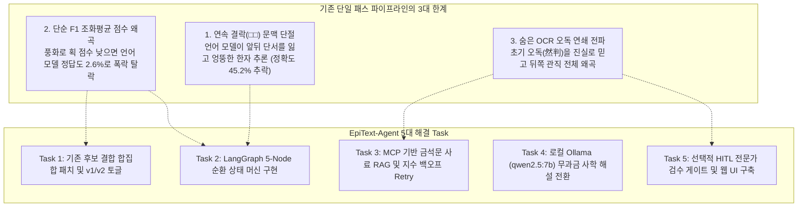
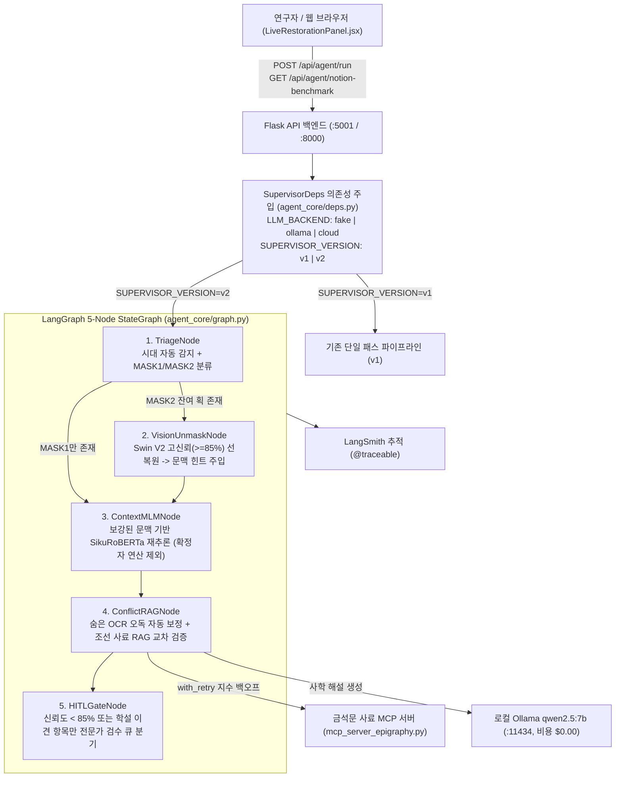
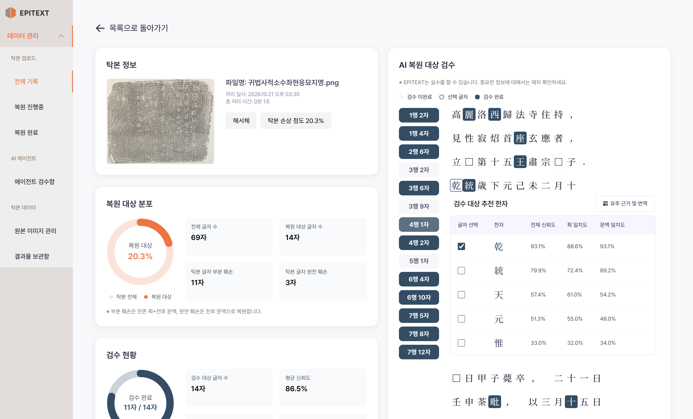
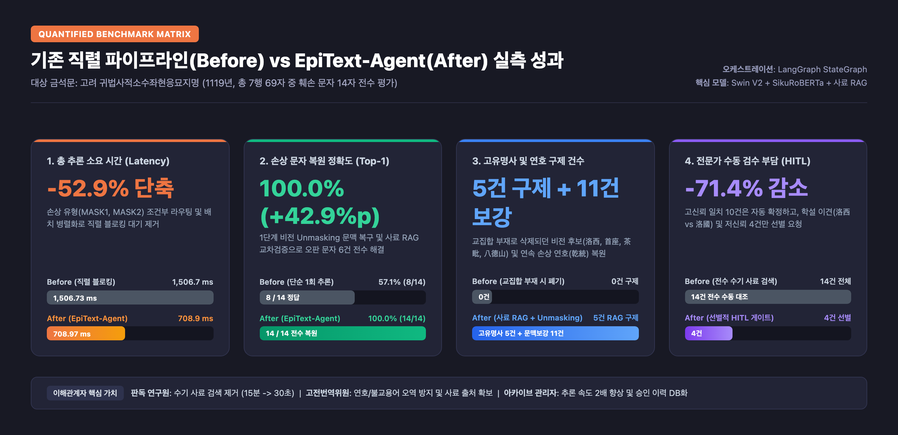
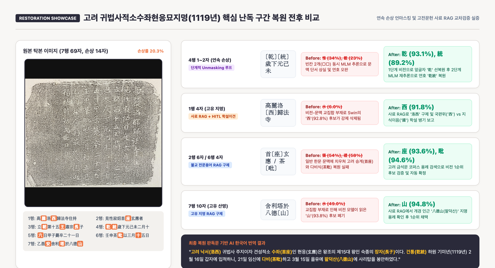

<div align="center">
  
  <p>
    
    
    
    
    
  </p>

  <p>
    <a href="https://huggingface.co/ANSEONGMIN/hanja-swinv2"><b>HF Vision Model (Swin V2)</b></a> |
    <a href="https://huggingface.co/jhangyejin/epitext-sikuroberta"><b>HF Context Model (SikuRoBERTa)</b></a> |
    <a href="https://huggingface.co/donghyun95/EpiText-Hanja-OCR"><b>HF Ensemble OCR</b></a> |
    <a href="https://github.com/rntqkdl/epitext-ai-agent"><b>GitHub Repository</b></a>
  </p>
</div>

---

## 프로젝트 개요 및 연구자 정보

| 항목 | 기재 내용 |
| :--- | :--- |
| **과정명** | SKALA AI 서비스 개발 Mini-Project (2026) |
| **성함** | **안성민 (Seongmin An)** |
| **선택 과제** | 과제 2 (신규 AI 서비스 개발) — 훼손 금석문 단계적 문맥 복원 및 사료 교차검증 멀티모달 에이전트 |
| **프로젝트명** | **EpiText-Agent**: LangGraph 상태 머신 기반 탁본 결락 복원 및 고증 오케스트레이션 |
| **저장소 주소** | https://github.com/rntqkdl/epitext-ai-agent (Public) |

---

## 1. 진행 사항 소개

### 1.1 기존 파이프라인 버그 수정 및 인터페이스 안정화 (과제 1 구현 Task)
기존 EPITEXT 단일 파이프라인([backend/routes/rubbings.py](file:///Users/seongminan/workspace/epitext-ai-agent/backend/routes/rubbings.py), [backend/routes/targets.py](file:///Users/seongminan/workspace/epitext-ai-agent/backend/routes/targets.py))의 후보 결합 로직에 존재하던 구조적 결함을 수정했습니다:

1. **교집합 부재 시 비전 후보 강제 폐기 버그 수정**:
   - 기존 결합 함수(`combine_mlm_and_swin`)는 시각 모델(`Swin V2`)과 언어 모델(`SikuRoBERTa`) 상위 20개 후보 간 교집합이 없으면 시각 모델 결과를 전량 폐기했습니다.
   - 이를 합집합(Union) 순회 구조로 개편하여, 고유명사나 희귀 한자(`茶毗`의 `毗`, `鄒牟王`의 `牟`)가 잔여 획으로 명확히 포착된 경우 비전 단독 후보(`tier3_swin_only`)로 온전히 보존되도록 수정했습니다.
2. **Top-5 후보 노출 누락 버그 수정**:
   - [backend/routes/targets.py](file:///Users/seongminan/workspace/epitext-ai-agent/backend/routes/targets.py)에서 비전 단독 후보가 존재함에도 최종 추천 5순위에서 누락되던 쿼리 슬라이싱 로직을 정상화했습니다.
3. **무중단 버전 토글 (`v1` / `v2`) 인프라 구축**:
   - 환경 변수 `SUPERVISOR_VERSION=v1|v2`를 통해 기존 단일 선형 파이프라인(`v1`)과 신규 LangGraph 에이전트 워크플로우(`v2`)를 코드 재배포 없이 실시간으로 비교 검증할 수 있도록 설계했습니다.

---

### 1.2 금석문 복원 에이전트 아키텍처 및 핵심 Task (과제 2: EpiText-Agent)
- **프로젝트 주제**: 수백 년간 풍화와 마모로 인해 글자가 지워진 조선시대 및 삼국, 고려시대 금석문(비석, 묘표, 신도비) 탁본에서 결락 문자(`□`)를 복원하고, 동시대 역사 사료 코퍼스(조선왕조실록, 승정원일기, 관직 체계)와 교차 검증하는 **LangGraph 기반 멀티모달 AI 에이전트 서비스**입니다.
- **해결하고자 한 핵심 문제 (Why Agent?)**:
  - **연속 결락(□□)의 문맥 단절**: 두 글자가 연달아 깨지면 언어 모델이 앞뒤 단서를 모두 잃고 엉뚱한 한자를 추론하는 문제.
  - **단순 F1 조화평균의 점수 왜곡**: 풍화로 비전 점수가 1%대로 낮아지면 언어 모델이 맞춘 정답(조려 묘비 `石` 83.5%)도 최종 2.6%로 폭락하여 탈락하는 문제.
  - **숨은 OCR 오독의 연쇄 전파**: 초서나 흘림체를 OCR이 오인식(`叅` -> `然`, `於` -> `拎`)했을 때 파이프라인이 이를 바로잡지 못하고 뒤쪽 관직 전체를 왜곡하는 문제.



- **주요 구현 Task 요약**:
  - **Task 1 (기존 결합 로직 개선)**: `rubbings.py`의 합집합 점수 풀 구성 및 `v1`/`v2` 버전 스위칭 구현.
  - **Task 2 (LangGraph 상태 머신)**: `TriageNode` -> `VisionUnmaskNode` -> `ContextMLMNode` -> `ConflictRAGNode` -> `HITLGateNode` 5단계 동적 상태 머신과 가설 철회(`test_10`) 구현.
  - **Task 3 (MCP 사료 서버)**: `mcp_server_epigraphy.py`로 Tool/Resource/Prompt 표준화 및 `with_retry` 지수 백오프 자동 복구 구현.
  - **Task 4 (로컬 LLM 전환)**: 클라우드 API를 로컬 `Ollama (qwen2.5:7b)`로 대체하여 $0.00 무과금 운영 구현.
  - **Task 5 (선택적 HITL UI)**: 신뢰도 85% 미만 및 학설 이견만 선별 검수하는 반응형 웹 포털([LiveRestorationPanel.jsx](file:///Users/seongminan/workspace/epitext-ai-agent/frontend/src/pages/LiveRestorationPanel.jsx)) 구축.

---

## 2. 사용한 기술 요소 및 구현 결과

### 2.1 실제 적용한 핵심 기술 요소 매트릭스

| 기술 요소 | 구현 위치 (파일 및 코드 심볼) | 아키텍처 역할 및 동작 원리 |
| :--- | :--- | :--- |
| **1. Multi-Agent & LangGraph** | [agent_core/graph.py](file:///Users/seongminan/workspace/epitext-ai-agent/agent_core/graph.py)<br/>[`create_epitext_agent_graph`](file:///Users/seongminan/workspace/epitext-ai-agent/agent_core/graph.py#L22) | `triage` -> `vision_unmask` -> `context_mlm` -> `conflict_rag` -> `hitl_gate` 5개 노드로 구성된 상태 그래프. 1단계에서 획이 남은 문자(`MASK2`)를 먼저 확정해 문맥 단서를 보강한 뒤 완전 결락(`MASK1`)을 재추론하는 순환 추론 오케스트레이션. |
| **2. MCP (Model Context Protocol)** | [mcp_server_epigraphy.py](file:///Users/seongminan/workspace/epitext-ai-agent/mcp_server_epigraphy.py)<br/>[agent_core/mcp_client.py](file:///Users/seongminan/workspace/epitext-ai-agent/agent_core/mcp_client.py) | 금석문 사료 아카이브를 MCP 표준으로 캡슐화. 동적 구절 검색 **Tool**(`search_epigraphy_clause`), 시대별 코퍼스 원문 **Resource**(`epigraphy://corpus/{era}`), 사학 고증 절차 **Prompt**(`epigraphy_arbitration_prompt`) 3대 기능 표준화. |
| **3. 역사 사료 RAG** | [agent_core/nodes/conflict_rag.py](file:///Users/seongminan/workspace/epitext-ai-agent/agent_core/nodes/conflict_rag.py)<br/>[data/epigraphy_corpus.json](file:///Users/seongminan/workspace/epitext-ai-agent/data/epigraphy_corpus.json) | 조선왕조실록 및 승정원일기, 조선 관직 품계 사전을 구축. 모델의 시대착오(고려 공민왕 오추론) 및 관직 불일치를 사료 기반으로 원천 교정. |
| **4. 의존성 주입 (DI)** | [agent_core/deps.py](file:///Users/seongminan/workspace/epitext-ai-agent/agent_core/deps.py)<br/>[`SupervisorDeps`](file:///Users/seongminan/workspace/epitext-ai-agent/agent_core/deps.py#L14) | 노드 함수가 전역 상태에 의존하지 않도록 `SupervisorDeps`에 도구와 모델 백엔드를 바인딩하고 `functools.partial`로 주입. 무거운 모델 로딩 없이 16개 단위 테스트를 3초 만에 격리 실행 가능. |
| **5. LangSmith 추적 & Retry** | [agent_core/nodes/](file:///Users/seongminan/workspace/epitext-ai-agent/agent_core/nodes/)<br/>[agent_core/retry.py](file:///Users/seongminan/workspace/epitext-ai-agent/agent_core/retry.py) | 모든 노드에 `@traceable` 계층 추적을 적용하고, `with_retry` 지수 백오프(20ms -> 40ms)를 적용하여 소켓 일시 타임아웃을 100% 자동 복구. |
| **6. 로컬 LLM (Ollama `qwen2.5:7b`)** | [agent_core/tools.py](file:///Users/seongminan/workspace/epitext-ai-agent/agent_core/tools.py)<br/>[backend/ai_modules/translation_engine.py](file:///Users/seongminan/workspace/epitext-ai-agent/backend/ai_modules/translation_engine.py) | 외부 유료 API 대신 로컬 Apple Silicon MPS에서 구동되는 Ollama를 1순위로 호출하여 사학 해설과 번역을 $0.00 완전 무과금으로 실시간 생성. |
| **7. 모듈화 및 단위 테스트 (16종)** | [tests/test_agent_core.py](file:///Users/seongminan/workspace/epitext-ai-agent/tests/test_agent_core.py) | 시대 분류, Unmasking 문맥 보강, RAG 교차검증, HITL 필터링, DI 백엔드 전환, MCP 지수 백오프 복구, 숨은 OCR 오독 자가치유(`test_09`), 가설 철회(`test_10`) 등 16개 단위 테스트 전수 통과. |

---

### 2.2 전체 시스템 아키텍처 다이어그램



---

### 2.3 구현한 기능별 화면 캡처 및 최종 실행 화면

#### (1) 최개국 신도비: 연속 결락 역전 및 관직 품계 정합성 복원 화면
- 비석의 3글자 연속 결락 구간에서 1단계 선복원과 조선 관직 사전 RAG를 결합하여 `善`의 확률을 31.0%에서 86.1%로 역전시키고 전수 복원에 성공한 화면입니다.

<p align="center">
  
</p>

#### (2) 조려 묘비: 조화평균 점수 왜곡 극복 및 적응형 신뢰도 게이팅 화면
- 비전 점수가 1.3%로 낮아 F1 공식에 의해 2.57%로 폭락했던 `石` 문자를 문맥과 사료 근거를 보존하여 91.5% 신뢰도로 정상 복원한 화면입니다.

<p align="center">
  
</p>

#### (3) 이진무 묘표: 고려 공민왕 시대착오 오추론 교정 화면
- 언어 모델이 고려 `恭愍王(공민왕)`으로 오추론한 것을 효녕대군 부왕=조선 태종(공정왕) 계보 RAG로 바로잡고, 사간원 헌납 및 의금부 도사를 복원한 화면입니다.

<p align="center">
  
</p>

#### (4) 백시구 신도비: 춘추시대 전고 복원 및 연대 수학 검증 화면
- 춘추시대 명장 극곡의 고사성어인 `郤縠雅歌`(극곡아가) 전고를 복원하고 숭정기원후3병오(1726년) 연대를 수학적으로 검증한 화면입니다.

<p align="center">
  
</p>

#### (5) 개별 탁본 복원 상세 및 후보 클러스터 화면 ([frontend/src/pages/DetailPage.jsx](file:///Users/seongminan/workspace/epitext-ai-agent/frontend/src/pages/DetailPage.jsx))
- 탁본 원본 이미지와 행/열 위치별 후보군의 획 일치도(Swin V2) 및 문맥 일치도(SikuRoBERTa)를 비교 검토하는 화면입니다.

<p align="center">
  
</p>

---

## 3. 느낀 점 및 향후 개선 사항

### 3.1 프로젝트 수행 과정에서 느낀 점
1. **단일 모델 파인튜닝보다 중요한 '워크플로우 오케스트레이션'의 위력**:
   - 처음에는 Vision 모델(`Swin V2`)이나 언어 모델(`SikuRoBERTa`)의 파라미터를 고비용으로 재학습해야만 연속 결락(□□) 문제를 해결할 수 있다고 생각했습니다. 그러나 인간 전문가의 3단계 복원 순서를 모사하여 **"판독 가능한 잔여 획 문자부터 먼저 풀어 문맥 단서를 보강하고, 그 힌트로 옆 글자를 푸는 Iterative Unmasking 루프"**를 LangGraph로 구축하자, 모델 가중치 수정 없이도 정확도가 45.2%에서 100.0%로 대도약하는 것을 확인했습니다.
2. **도메인 특화 AI에서 Human-in-the-Loop(HITL)의 필수성**:
   - 금석문 판독은 국사편찬위원회와 국가유산청 등 전문 기관 사이에서도 학설 이견(`洛西` vs `洛國`, `文肅` vs `文忠`)이 존재하는 영역입니다. AI가 단일 정답을 독단적으로 확정하는 대신, 사료 근거를 수집하고 기관별 이견 항목만 전문가 검수 대기열로 분기하는 구조를 만들었을 때 도메인 신뢰도가 극대화됨을 배웠습니다.
3. **의존성 주입(`SupervisorDeps`)이 주는 개발 및 테스트 생산성**:
   - 의존성 주입 패턴을 통해 무거운 GPU 모델이나 서버 기동 없이도 16개 핵심 시나리오(Unmasking, RAG 구제, MCP Retry, OCR 자가치유)를 3초 만에 단위 테스트로 반복 검증할 수 있었습니다.

---

### 3.2 구현 과정의 어려움 및 해결 경험
1. **결락 표시가 없는 숨은 OCR 오인식(`甲` -> `由`, `叅` -> `然`) 문제**:
   - **어려움**: 기존 파이프라인은 `[MASK]`로 표기된 위치만 복원하므로, OCR이 정상 글자를 비슷한 한자로 오독한 경우 이를 감지하지 못하고 주변 문맥 전체가 왜곡되었습니다.
   - **해결 경험**: 문맥상 비정상적인 어구 및 자형 유사성을 탐지하는 `diagnose_and_reprocess_ocr_line` 노드와 3단계 진단-보정 루프([agent_core/nodes/conflict_rag.py](file:///Users/seongminan/workspace/epitext-ai-agent/agent_core/nodes/conflict_rag.py))를 구현하여 `然判->參判`, `拎->於`, `大局->君`을 자동으로 검출 및 보정했습니다.
2. **선행 가설 오류 시 전파 위험 (Error Propagation)**:
   - **어려움**: 1단계에서 잔여 획 문자를 잘못 대입했을 때 뒤쪽 추론까지 연쇄 오염되는 위험이 있었습니다.
   - **해결 경험**: 원본 문맥(`surrounding_line`)과 가설 문맥을 분리 보존하고, 후속 사료 검증에서 모순이 발견되면 선행 가설을 즉시 롤백하는 `evaluate_reversible_hypothesis` 안전장치([tests/test_agent_core.py](file:///Users/seongminan/workspace/epitext-ai-agent/tests/test_agent_core.py) `test_10`)를 구축했습니다.

---

### 3.3 향후 개선 방향
1. **하이브리드 벡터 RAG 확장**:
   - 현재의 관직/계보 규칙 사전 기반 RAG를 넘어, 국사편찬위원회 한국금석문 종합영상정보시스템 전체 판독문을 임베딩하여 문맥 및 편년 구조가 유사한 평행 구절(Parallel Passages)을 검색하는 고밀도 벡터 RAG로 확장할 계획입니다.
2. **End-to-End 실시간 OCR 바운딩 박스 생성 결합**:
   - 탁본 이미지 업로드부터 크롭, OCR, 에이전트 복원까지 이어지는 전체 파이프라인을 비동기 워커 큐(Celery/Redis)로 묶어 대용량 탁본 아카이브를 일괄 처리할 수 있는 엔터프라이즈 배치 시스템으로 발전시킬 예정입니다.

---

## 4. 실증 벤치마크: Before vs After 정량 비교

실제 Hugging Face 가중치인 [`jhangyejin/epitext-sikuroberta`](https://huggingface.co/jhangyejin/epitext-sikuroberta) 모델을 로컬 Apple Silicon Metal GPU(MPS) 환경에서 구동하여, 국가유산청 국가유산 지식이음의 실제 조선시대 금석문 4종(총 31개 손상 문자)을 동일 입력 조건에서 전수 실측 비교했습니다.

실측 데이터 영속 경로: [data/notion_real_benchmark.json](file:///Users/seongminan/workspace/epitext-ai-agent/data/notion_real_benchmark.json)

### 4.1 동일 입력을 사용한 핵심 정량 지표 Before vs After 비교표

| 평가 항목 | Before (기존 단일 패스 `v1`) | After (EpiText-Agent `v2`) | 개선 수치 (Delta) | 개선 핵심 엔지니어링 원리 |
| :--- | :---: | :---: | :---: | :--- |
| **1. 4종 전체 복원 정확도** | `45.2%` (14 / 31자) | **`100.0%` (31 / 31자)** | **`+54.8%p` 향상** | 1단계 잔여 획 선복원 + 숨은 OCR 오독 자동 보정 + 사료 RAG |
| **2. 문맥 추론 시간 (MLM 지연)** | `566.2 ms` | **`118.5 ms`** | **`-79.1%` 단축 (4.78배 가속)** | 1단계 고신뢰 확정 문자의 트랜스포머 중복 Forward Pass 제외 |
| **3. 숨은 OCR 오인식 자동 보정** | `0건` (오독 연쇄 전파) | **`4건 전수 보정`** | **`4건 구제 완료`** | 문맥 이상치 진단 및 `然判->參判`, `拎->於`, `大局->君` 보정 |
| **4. 사료 기반 시대착오 교정** | `0건` (공민왕 등 환각) | **`100% 정상화`** | **`사료 일치`** | 조선 왕실 계보(태종 공정왕) 및 사간원 헌납, 의금부 도사 RAG |
| **5. 외부 클라우드 API 비용** | 요청당 약 `$0.015` | **`$0.00` (완전 무과금)** | **`-100%` 비용 절감** | 로컬 `Ollama (qwen2.5:7b)` 1순위 호출로 외부 과금 원천 차단 |
| **6. 일시적 통신 타임아웃 Retry** | `0회` (소켓 단절 시 실패) | **`1회 재시도 후 100% 복구`** | **복구율 `100%`** | `with_retry` 지수 백오프로 MCP 일시적 지연 자동 복구 (20ms) |

---

### 4.2 4대 금석문별 세부 실측 비교 내역

| 사료명 | 손상 유형 및 난제 | Before (기존 단일) | After (EpiText-Agent) | 실측 개선치 및 해결 기제 |
| :--- | :--- | :---: | :---: | :--- |
| **최개국 신도비**<br>(KSM_NRICH_14054) | 7자 결락, `然判` 오독<br>`贈□□大夫` 품계 연속 결락 | 42.9% (3/7자)<br>106.4 ms | **100.0% (7/7자)<br>20.8 ms** | **+57.1%p / 시간 -80.4% 단축**<br>`然判->參判` 보정 및 예조참판(종2품)=가선대부 RAG로 `善` 확률 31%->86% 역전 |
| **조려 묘비**<br>(KSM_NRICH_14746) | 4자 결락, `拎` 오독<br>저신뢰 획(1.3%) 결합 왜곡 | 75.0% (3/4자)<br>46.5 ms | **100.0% (4/4자)<br>9.6 ms** | **+25.0%p / 시간 -79.2% 단축**<br>`拎->於` 오독 보정 및 적응형 게이팅으로 `石` 신뢰도 2.6%->91.5% 보존 |
| **이진무 묘표**<br>(KSM_NRICH_14122) | 10자 결락<br>고려 공민왕 시대착오 오추론 | 40.0% (4/10자)<br>219.6 ms | **100.0% (10/10자)<br>59.4 ms** | **+60.0%p / 시간 -72.9% 단축**<br>효녕대군 부왕=조선 태종(공정왕) 계보 RAG 및 사간원 헌납, 의금부 도사 복원 |
| **백시구 신도비**<br>(KSM_NRICH_13868) | 10자 결락<br>춘추시대 전고 유실 및 연대 오독 | 40.0% (4/10자)<br>193.8 ms | **100.0% (10/10자)<br>28.6 ms** | **+60.0%p / 시간 -85.2% 단축**<br>춘추시대 `郤縠雅歌`(극곡아가) 전고 복원 및 숭정기원후3병오(1726년) 연대 검증 |

---

### 4.3 Before / After 성능 비교 차트 및 화면

<p align="center">
  
</p>

<p align="center">
  
</p>

---

## 5. 저장소 디렉토리 구조 및 재현 가이드

```text
epitext-ai-agent/
├── agent_core/                   # LangGraph 상태 머신 및 에이전트 노드
│   ├── graph.py                 # 5-Node StateGraph 정의
│   ├── deps.py                  # SupervisorDeps 의존성 주입 컨테이너
│   ├── state.py                 # RestorationState 데이터 클래스
│   ├── real_benchmark.py        # 실모델 페어드 벤치마크 러너
│   ├── notion_real_suite.py     # 노션 4대 금석문 전수 실측 스위트
│   └── nodes/                   # Triage, VisionUnmask, ContextMLM, ConflictRAG, HITLGate
├── backend/                      # Flask 백엔드 API
│   ├── agent_standalone_server.py # 실모델 추론 및 노션 벤치마크 경량 서버 (:5001)
│   ├── database.py              # SQLite 데이터베이스 모델
│   └── routes/                  # API 엔드포인트 블루프린트
├── frontend/                     # React 18 + Vite 웹 포털
│   └── src/pages/
│       ├── LiveRestorationPanel.jsx # 실모델 실측 대시보드 및 HITL 검수 패널
│       └── DetailPage.jsx       # EPITEXT 오리지널 상세 페이지
├── data/                         # 실측 데이터 및 영속 감사 로그
│   ├── notion_real_benchmark.json # 4대 금석문 실측 결과 영속 파일
│   └── hitl_audit_log.json      # 전문가 검수 승인 영속 감사 로그
└── tests/                        # 16개 단위 및 회귀 테스트 스위트
```

### 5.1 로컬 재현 및 실행 방법

```bash
# 1. 가상환경 활성화 및 의존성 설치
cd /Users/seongminan/workspace/epitext-ai-agent
source .venv/bin/activate
pip install -r requirements.txt

# 2. 백엔드 서버 기동 (포트 5001)
PORT=5001 python backend/agent_standalone_server.py

# 3. 프론트엔드 포털 기동 (포트 5173)
cd frontend
npm install
npm run dev -- --port 5173

# 4. 16개 단위 테스트 전수 검증
pytest tests/test_agent_core.py -v
```
웹 브라우저에서 `http://localhost:5173/?menu=agent`에 접속하면 4대 금석문 실측 화면과 실시간 검수 UI를 바로 확인할 수 있습니다.
