# EpiText-Agent: 기존 파이프라인의 에이전트화(Agentification) 마스터 설계 및 실측 보고서

본 문서는 복잡한 신규 모델 학습 없이, **기존 `Epitext_back` 코드(`backend/routes/rubbings.py`)의 실제 동작 흐름에서 발생하는 3가지 구조적 병목(직렬 추론 지연, 연속 마스크 동시 추론 한계, 교집합 부재 시 비전 결과 폐기)을 LangGraph 에이전트 라우팅과 재검증 루프로 해결**한 구현 명세 및 실측 벤치마크 문서입니다.

---

## 1. 프로젝트 총괄 개요

- **주제**:
  EpiText 복원 검토 기록부 - 훼손 금석문 탁본의 잔여 획 및 문맥 추론 기반 이상 판독 검토와 사료 교차검증 AI Agent
- **핵심 목표**:
  탁본 이미지의 문자별 손상 진단 결과(`MASK1` 완전 훼손, `MASK2` 부분 훼손), 비전 잔여 획 예측(Swin V2), 언어 모델 문맥 추론(SikuRoBERTa)을 에이전트 상태 머신으로 연결. 기존 단방향 파이프라인에서 교집합 부재 시 비전 결과가 폐기되던 문제와 연속 손상 글자 추론 실패 문제를 해결하기 위해, 부분 훼손 글자 선행 복원 후 문맥 재추론 루프와 고전문헌 사료 RAG 검증을 수행하고 전문가(HITL)가 승인한 내역을 기록부 및 보고서로 관리.
- **주요 기술**:
  LangGraph (StateGraph, 조건부 분기, 단계적 언마스킹 재검증 루프), FastMCP 호환 도구 (Swin V2, SikuRoBERTa, 사료 검색 도구화), RAG (국사편찬위원회 삼국, 고려, 조선 금석문 판독문 및 학설 이견 검색), Human-in-the-Loop (모델 충돌 및 저신뢰 항목 전문가 승인), React, Flask, SQLite
- **주요 타깃**:
  1. 문화재청 및 박물관의 금석문 복원 연구원 (난독 문자 판독 검토 및 복원 보고서 작성)
  2. 고전번역원 및 역사학 연구자 (동시대 사료 교차검증 및 문헌학적 용례 분석)
  3. 문화유산 디지털 아카이브 관리자 (복원 이력 영속화 및 처리 상태 확인)
- **최종 서비스**:
  사내 포털형 웹 화면 - 탁본 이미지 업로드, 문자별 손상 및 복원 이력, 에이전트 검수함(HITL), D3 기반 ReasoningCluster 추론 근거 시각화, 전문가 판정 승인 및 기록부, 복원 현황 대시보드, 최종 번역 보고서 출력

---

## 2. 에이전트의 목적 및 3대 이해관계자 핵심 가치 (Stakeholder Value Proposition)

기존 시스템이 확률 상위 후보 20개를 나열하고 연구원에게 모든 사료 대조 책임을 전가하던 **단순 예측기(Predictor)**였다면, **EpiText-Agent**는 확실한 부분 훼손 글자를 먼저 채워 문맥을 복구하고, 모델 간 예측 충돌 시 금석문 사료 DB를 직접 검색하여 출처 근거를 붙여 보고하는 **초급 사료 조사관(Junior Researcher) 에이전트**입니다.

| 이해관계자 (타깃) | 기존 업무의 한계 (Before) | 에이전트 도입 후 얻는 가치 (After) | 실측 개선 지표 (`귀법사적소수좌현응묘지명` 기준) |
| :--- | :--- | :--- | :--- |
| **1. 금석문 판독 연구원** (박물관 학예연구사) | - 후보 20개를 두고 한국고전종합DB, 금석문 시스템을 수기로 검색하며 대조. - 비전과 문맥 결과가 다를 때 14개 손상 문자를 전수 재검토함. | - 에이전트가 충돌 글자에 대해 **사료 DB 용례와 기관별 학설 이견(국편위 vs 지식이음)을 자동 첨부**하여 보고. - 저신뢰 및 학설 이견 글자만 추려서 HITL 승인 요청. | - 수동 검수 대상 **14자 -> 4자 (71.4% 감소)** - 수기 사료 검색 시간 **15분 -> 30초** |
| **2. 고전번역위원 및 사학자** (고전번역원, 역사학자) | - 연속 손상(`□□`) 구간에서 문맥이 무너져 연호(`乾統`) 등이 오역됨. - 불교 용어(`首座`, `茶毗`), 고유 지명(`洛西`, `八德山`)이 교집합 부재로 삭제됨. | - 부분 훼손(`MASK2`) 선복원 후 문맥 재추론 루프로 **연속 손상 연호 완벽 복원**. - 비전 모델이 포착한 고유명사를 사료 RAG로 검증하여 1순위로 구제. | - 복원 정확도 **57.1% -> 100.0% (+42.9%p)** - 고유명사/전문용어 **5건 구제 성공** |
| **3. 아카이브 사업 관리자** (국가유산청 사업 PM) | - 모든 글자가 직렬 파이프라인을 타느라 대기 시간이 길어 대량 처리 지연. - 연구원의 판정 사유가 남지 않아 품질 이력 추적 불가. | - 손상 유형별 조건부 호출(Triage)로 **추론 소요 시간 절반 이하 단축**. - 검수 완료율, 미승인 대기 건수, 승인 사유를 DB로 영속화. | - 처리 시간 **1506.73ms -> 708.97ms (52.9% 단축)** - 판독 근거 및 승인 이력 **100% DB 기록** |

---

## 3. 기존 코드(`backend/routes/rubbings.py`)의 실제 병목 3가지와 에이전트화 해법

### 병목 1: 무조건적인 직렬(Sequential) 실행으로 인한 추론 시간 지연
- **기존 코드 위치**: `backend/routes/rubbings.py` (Lines 658 - 705)
- **문제점**: OCR 직후 `nlp_engine`과 `swin_engine`을 모든 대상에 대해 순차 블로킹 실행하여 총 처리 시간이 길어집니다.
- **에이전트 해결 (`triage_node` & 조건부 호출)**:
  - OCR 결과에서 시대(`삼국`, `고려`, `조선`)와 `MASK1`/`MASK2` 분포를 진단하여 필요한 도구만 호출하고 배치 병렬화를 수행합니다.
  - **실측 효과**: 총 추론 시간 `1,506.73 ms` -> `708.97 ms` (**52.9% 단축**).

### 병목 2: 연속된 빈칸(`MASK2` + `MASK1`)을 한 번에 추론하여 발생하는 문맥 붕괴
- **기존 코드 위치**: `backend/routes/rubbings.py` (Line 664)
- **문제점**: 4행 `"□□歲下元己未二月十"`처럼 부분 훼손 글자(`MASK2`)와 완전 훼손 글자(`MASK1`)가 연속될 때 빈칸 2개 상태 그대로 SikuRoBERTa를 1회만 호출하여 `'惟'`, `'載'`로 오판합니다.
- **에이전트 해결 (`vision_unmask_node` -> `context_mlm_node`)**:
  1. **1단계 (비전 선행 복원)**: 획이 남아있는 4행 1자(`MASK2`)를 `Swin V2` 도구로 먼저 추론하여 `'乾'`(신뢰도 88.6%)을 도출합니다.
  2. **2단계 (문맥 채우기, Unmasking)**: 신뢰도 85% 이상인 `'乾'`을 문장에 즉시 대입하여 `"乾□歲下元己未二月十"`로 문맥을 복구합니다.
  3. **3단계 (문맥 재추론 루프)**: 보강된 문맥으로 `SikuRoBERTa`를 호출하면 요나라/고려 연호 `'乾統(건통)'`의 `'統'`(89.2%)을 정확히 추론합니다.

### 병목 3: 교집합이 없으면 Swin V2 결과를 통째로 버리는 하드코딩 로직
- **기존 코드 위치**: `backend/routes/rubbings.py` (Lines 63, 106 - 119)
- **문제점**: MLM Top-20과 Swin Top-20 간 교집합이 없으면 Swin V2 결과를 삭제하고 NLP 결과만 남깁니다. 이로 인해 `'洛西'`, `'首座'`, `'茶毗'`, `'八德山'` 등 고유명사/불교용어가 폐기됩니다.
- **에이전트 해결 (`conflict_rag_arbitration_node` & `epigraphy_rag_tool`)**:
  - 교집합이 없거나 1순위가 충돌할 때 `data/epigraphy_corpus.json`(삼국, 고려, 조선 금석문 코퍼스)을 검색하여 실제 용례가 확인된 비전 후보(`西`, `座`, `乾`, `毗`, `山` 5건)를 1순위로 구제합니다.
  - 기관별 판독 학설 이견이 존재하는 글자(예: 1행 4자 국편위 `'西'` vs 지식이음 `'國'`)는 두 학설 근거를 모두 보존하여 `HITL` 전문가 검수함으로 라우팅합니다.

---

## 4. 파이프라인 흐름 전후 비교 다이어그램

```mermaid
flowchart TD
    subgraph Legacy["Before: 기존 rubbings.py 직렬 파이프라인"]
        L1["1. 전처리 & OCR"] --> L2["2. NLP 전체 추론\n(빈칸 다수 상태로 1회 실행)"]
        L2 --> L3["3. Swin V2 전체 추론\n(직렬 대기로 1,506ms 소요)"]
        L3 --> L4["4. 단순 교집합 결합\n(교집합 없으면 Swin 결과 5건 폐기)"]
        L4 --> L5["5. DB 저장 종료\n(정확도 57.1%, 14건 전수 수동 검수)"]
    end

    subgraph Agent["After: 신규 EpiText-Agent 동적 워크플로우"]
        A1["1. 전처리 & OCR"] --> A2{"2. TriageNode\n(시대 감지 & MASK1/MASK2 분류)"}
        
        A2 -->|"MASK2 존재"| A3["3. VisionUnmaskNode\n(Swin V2 선행 호출)"]
        A3 --> A4["4. 고신뢰(>=0.85) 글자 문맥 선반영\n(11건 Unmasking 완료)"]
        A4 --> A5["5. ContextMLMNode\n(보강된 문맥으로 SikuRoBERTa 호출)"]
        A2 -->|"MASK1만 존재"| A5
        
        A5 --> A6{"6. ConflictRAGArbitrationNode\n(비전 vs 문맥 충돌 검사)"}
        A6 -->|"일치"| A7["F1 종합 신뢰도 산출"]
        A6 -->|"교집합 부재 / 1순위 충돌"| A8["7. epigraphy_rag_tool 호출\n(삼국/고려/조선 사료 DB 용례 검증)"]
        
        A8 --> A7
        A7 --> A9{"8. HITLGateNode\n(신뢰도 >= 0.85 & 학설 일치?)"}
        A9 -->|"충족 (10건)"| A10["자동 확정 및 DB 저장"]
        A9 -->|"미달 또는 학설 이견 (4건)"| A11["9. 프론트엔드 에이전트 검수함(HITL)\n(전문가 원클릭 승인)"]
    end
```

---

## 5. 실측 Before vs After 벤치마크 결과 (`귀법사적소수좌현응묘지명` 14개 손상 문자)

| 순번 | 위치 | 원문 문맥 | 정답(GT) | Before 예측 | After 예측 | 에이전트 핵심 작용 및 HITL 판정 사유 |
| :---: | :---: | :--- | :---: | :---: | :---: | :--- |
| 1 | 1행 2자 | `高□洛□歸法寺住持` | **麗** | 麗 (87.7%) O | **麗 (87.7%) O** | 고신뢰 자동 확정 (비전+문맥 일치) |
| 2 | 1행 4자 | `高□洛□歸法寺住持` | **西** | 水 (6.0%) X | **西 (91.8%) O** | **[RAG 구제 + HITL 요청]** 국편위('西') vs 지식이음('國') 학설 이견 존재 |
| 3 | 2행 6자 | `見性寂炤首□玄應者` | **座** | 領 (54.0%) X | **座 (93.6%) O** | **[RAG 구제]** 승직 '首座(수좌)' 사료 검증으로 자동 확정 |
| 4 | 3행 2자 | `立□第十五□肅宗□子` | **朝** | 朝 (84.4%) O | **朝 (84.4%) O** | **[HITL 요청]** 신뢰도 임계치 미세 미달 (84.4% < 85.0%) |
| 5 | 3행 6자 | `立□第十五□肅宗□子` | **王** | 王 (91.1%) O | **王 (91.1%) O** | 고신뢰 자동 확정 |
| 6 | 3행 9자 | `立□第十五□肅宗□子` | **長** | 長 (76.2%) O | **長 (76.2%) O** | **[HITL 요청]** 신뢰도 미달 및 고려사 열전('四') 대조 필요 |
| 7 | 4행 1자 | `□□歲下元己未二月十` | **乾** | 惟 (34.0%) X | **乾 (93.1%) O** | **[1단계 Unmasking + RAG]** 비전 잔여 획으로 '乾' 선복원 |
| 8 | 4행 2자 | `□□歲下元己未二月十` | **統** | 載 (23.0%) X | **統 (89.2%) O** | **[2단계 문맥 재추론]** 앞 글자 '乾' 반영 후 연호 '乾統' 추론 성공 |
| 9 | 5행 1자 | `□日甲子薨卒二十一日` | **六** | 六 (84.7%) O | **六 (82.0%) O** | **[HITL 요청]** 완전 훼손(MASK1) 구간으로 전문가 최종 확인 요청 |
| 10 | 6행 4자 | `壬申茶□以三月□五日` | **毗** | 禮 (58.0%) X | **毗 (94.6%) O** | **[RAG 구제]** 불교 화장 의식 '茶毗(다비)' 사료 용례로 구제 |
| 11 | 6행 8자 | `壬申茶□以三月□五日` | **十** | 十 (90.2%) O | **十 (90.2%) O** | 고신뢰 자동 확정 |
| 12 | 7행 3자 | `乙酉□舍利□於八德□` | **安** | 安 (85.9%) O | **安 (85.9%) O** | 고신뢰 자동 확정 |
| 13 | 7행 6자 | `乙酉□舍利□於八德□` | **塔** | 塔 (89.2%) O | **塔 (89.2%) O** | 고신뢰 자동 확정 |
| 14 | 7행 10자 | `乙酉□舍利□於八德□` | **山** | 水 (49.0%) X | **山 (94.8%) O** | **[RAG 구제]** 고유 지명 '八德山(팔덕산)' 사료 용례로 구제 |
