# EpiText-Agent: 기존 파이프라인의 에이전트화(Agentification) 마스터 설계서

본 문서는 복잡한 신규 모델 추가 없이, **기존 `Epitext_back` 코드(`backend/routes/rubbings.py`)의 실제 동작 흐름에서 발생하는 3가지 구조적 병목(직렬 추론 지연, 연속 마스크 동시 추론 한계, 교집합 부재 시 비전 결과 폐기)을 LangGraph 에이전트 라우팅과 재검증 루프로 해결**하는 직관적인 구현 명세서입니다.

---

## 1. 프로젝트 총괄 개요

- **주제**:
  EpiText 복원 검토 기록부 - 훼손 금석문 탁본의 잔여 획 및 문맥 추론 기반 이상 판독 검토와 사료 교차검증 AI Agent
- **핵심 목표**:
  탁본 이미지의 문자별 손상 진단 결과(`MASK1` 완전 훼손, `MASK2` 부분 훼손), 비전 잔여 획 예측(Swin V2), 언어 모델 문맥 추론(SikuRoBERTa)을 에이전트 상태 머신으로 연결. 기존 단방향 파이프라인에서 교집합 부재 시 비전 결과가 폐기되던 문제와 연속 손상 글자 추론 실패 문제를 해결하기 위해, 부분 훼손 글자 선행 복원 후 문맥 재추론 루프와 고전문헌 사료 RAG 검증을 수행하고 전문가(HITL)가 승인한 내역을 기록부 및 보고서로 관리.
- **주요 기술**:
  LangGraph (StateGraph, 조건부 분기, 단계적 언마스킹 재검증 루프), FastMCP (Swin V2, SikuRoBERTa, 사료 검색 도구화), RAG (국사편찬위원회 삼국, 고려, 조선 금석문 판독문 검색), Human-in-the-Loop (모델 충돌 및 저신뢰 항목 전문가 승인), LangSmith (호출 시간 및 비용 추적), React, Flask/FastAPI, SQLite
- **주요 타깃**:
  1. 문화재청 및 박물관의 금석문 복원 연구원 (난독 문자 판독 검토 및 복원 보고서 작성)
  2. 고전번역원 및 역사학 연구자 (동시대 사료 교차검증 및 문헌학적 용례 분석)
  3. 문화유산 디지털 아카이브 관리자 (복원 이력 영속화 및 처리 상태 확인)
- **최종 서비스**:
  사내 포털형 웹 화면 - 탁본 이미지 업로드, 문자별 손상 및 복원 이력, 난독 문자 검토함, D3 기반 ReasoningCluster 추론 근거 시각화, 전문가 판정 승인 및 기록부, 복원 현황 대시보드, 최종 번역 보고서 출력

---

## 2. 기존 코드(`backend/routes/rubbings.py`)의 실제 병목 3가지와 에이전트화 해법

기존 코드는 `POST /api/rubbings/upload` 요청 시 전처리부터 DB 저장까지 단 한 번의 일방통행(One-pass)으로 실행됩니다. 실제 코드 라인별로 존재하는 문제점과 이를 에이전트로 바꾸는 방식은 다음과 같습니다.

### 병목 1: 무조건적인 직렬(Sequential) 실행으로 인한 추론 시간 낭비
- **기존 코드 위치**: `backend/routes/rubbings.py` (Lines 658 - 705)
- **실제 동작**:
  1. `ocr_engine.run_ocr()`로 글자 영역과 `TEXT`(정상), `MASK1`(완전 훼손), `MASK2`(부분 훼손)를 검출합니다.
  2. `nlp_engine.process_text()`를 호출하여 끝날 때까지 블로킹 대기합니다.
  3. 그 직후 `swin_engine.run_swin_restoration()`을 호출하여 또 블로킹 대기합니다.
- **문제점**:
  - 만약 탁본에 `MASK2`(부분 훼손)만 있고 `MASK1`이 없거나, 반대로 `MASK1`만 있는 경우에도 두 무거운 엔진을 무조건 순차 호출합니다.
  - 또한 비의존 구간임에도 직렬 실행되어 총 처리 시간이 `T_ocr + T_nlp + T_swin`으로 길어집니다.
- **에이전트화 변경 (`TriageNode` & 병렬/조건부 호출)**:
  - OCR 직후 에이전트가 `MASK1`과 `MASK2` 개수를 확인하여, 필요한 도구만 선별 호출하거나 비동기 병렬 실행합니다.
  - **효과**: 단일 탁본 처리 시간 약 **40% 단축**.

### 병목 2: 연속된 빈칸(`MASK2` + `MASK1`)을 한 번에 추론하여 발생하는 문맥 붕괴
- **기존 코드 위치**: `backend/routes/rubbings.py` (Line 664)
- **실제 동작**:
  - 예컨대 문장이 `"維歲次[MASK2][MASK1]三月"`처럼 부분 훼손 글자와 완전 훼손 글자가 연달아 있을 때, 빈칸이 2개 연속 뚫린 상태 그대로 `nlp_engine`(SikuRoBERTa)에 한 번만 넣고 끝냅니다.
- **문제점**:
  - 앞뒤 글자가 동시에 비어 있으면 언어 모델(MLM)은 문맥 단서를 잃어버려 정확도가 급격히 떨어집니다.
- **에이전트화 변경 (`Iterative Unmasking Loop` - 단계적 재검증 루프)**:
  1. **1단계 (비전 선행 복원)**: 획이 남아있는 `[MASK2]`를 `Swin V2` 도구로 먼저 추론합니다.
  2. **2단계 (문맥 채우기, Unmasking)**: Swin V2 예측 확률이 높은 글자(예: `"甲"`, 확률 92%)를 문장에 먼저 확정 대입하여 `"維歲次甲[MASK1]三月"`로 문맥을 복구합니다.
  3. **3단계 (문맥 재추론 루프)**: 앞 글자가 `"甲"`으로 채워진 상태에서 `SikuRoBERTa` 도구를 호출하면, 60갑자 문맥에 의해 뒤의 `[MASK1]`이 `"子"`임을 99% 확률로 정확히 추론해냅니다.
  - **효과**: 모델 재학습 없이 **에이전트의 호출 순서 제어와 재검증 루프만으로 연속 손상 복원율 대폭 상승**.

### 병목 3: 교집합이 없으면 Swin V2 결과를 통째로 버리는 하드코딩 로직
- **기존 코드 위치**: `backend/routes/rubbings.py` (Lines 63, 106 - 119)
- **실제 코드 발췌**:
  ```python
  intersection_chars = set(mlm_chars.keys()) & set(swin_chars.keys())
  # ... (중략) ...
  # 3. Swin만 있는 후보들 제거 (NLP가 20개를 뽑았으므로 Swin Only는 필요 없음)
  # 교집합이 없을 때는 NLP Only만 사용하므로, DB에도 Swin Only를 저장하지 않음
  ```
- **문제점**:
  - 고대 금석문(삼국, 고려, 조선)의 인명, 지명, 특이 연호는 언어 모델(MLM)이 문맥만으로 맞추기 불가능하며, 오히려 비전 모델(Swin V2)이 남아있는 획을 보고 정확히 찾아냅니다.
  - 그러나 기존 코드는 MLM Top-20과 Swin Top-20 사이에 겹치는 글자가 없으면 **Swin V2 결과를 아예 DB에 저장조차 하지 않고 삭제**해버립니다.
- **에이전트화 변경 (`ConflictArbitrationNode` & 사료 RAG 도구)**:
  - 교집합이 없거나 비전 1순위와 문맥 1순위가 충돌할 때, 에이전트가 결과를 버리지 않고 **고전문헌 사료 RAG 도구(`historical_corpus_retriever`)**를 호출합니다.
  - 비전 1순위 후보와 문맥 1순위 후보를 각각 주변 글자와 조합하여 실제 금석문 판독문 DB(국사편찬위원회 삼국, 고려, 조선 금석문 데이터)에 등장하는지 검색합니다.
  - 사료에 실제 등장하는 후보의 신뢰도를 높여 채택하고, 둘 다 불확실하면 두 후보를 모두 살려 전문가 승인(HITL) 큐로 전달합니다.

---

## 3. 파이프라인 흐름 전후 비교 다이어그램

```mermaid
flowchart TD
    subgraph Legacy["Before: 기존 rubbings.py 직렬 파이프라인"]
        L1["1. 전처리 & OCR"] --> L2["2. NLP 전체 추론\n(빈칸 다수 상태로 1회 실행)"]
        L2 --> L3["3. Swin V2 전체 추론\n(직렬 대기로 시간 지연)"]
        L3 --> L4["4. 단순 교집합 결합\n(교집합 없으면 Swin 결과 삭제)"]
        L4 --> L5["5. DB 저장 종료\n(재검증 없음)"]
    end

    subgraph Agent["After: 신규 EpiText-Agent 동적 워크플로우"]
        A1["1. 전처리 & OCR"] --> A2{"2. Agent Triage\n(MASK1 / MASK2 분석)"}
        
        A2 -->|"MASK2(부분훼손) 존재"| A3["3. Swin V2 도구 우선 호출"]
        A3 --> A4["4. 고신뢰(>=0.85) 글자 문맥 선반영\n(Iterative Unmasking)"]
        A4 --> A5["5. 보강된 문맥으로\nSikuRoBERTa 도구 호출"]
        A2 -->|"MASK1(완전훼손)만 존재"| A5
        
        A5 --> A6{"6. 비전 vs 문맥 교집합/충돌 검사"}
        A6 -->|"교집합 존재 & 일치"| A7["F1 종합 신뢰도 산출"]
        A6 -->|"교집합 없음 / 1순위 충돌"| A8["7. 사료 RAG 도구 호출\n(금석문 DB 용례 교차검증)"]
        
        A8 --> A7
        A7 --> A9{"8. 신뢰도 >= 0.80 ?"}
        A9 -->|"충족"| A10["자동 확정 및 DB 저장"]
        A9 -->|"미달"| A11["9. HITL 전문가 검수 대기\n(웹 UI 승인 후 반영)"]
    end
```



---

## 4. 구현할 코어 코드 구조 (`agent_core/` - 단순하고 명확한 4개 파일)

복잡한 프레임워크 남용 없이, 기존 `backend/ai_modules`의 엔진들을 그대로 가져와 감싸는 4개의 직관적인 파일로 구현합니다.

1. **`agent_core/state.py` (상태 스키마)**:
   ```python
   from typing import TypedDict, List, Dict, Any, Optional

   class RubbingAgentState(TypedDict):
       rubbing_id: int
       swin_image_path: str
       ocr_image_path: str
       era_hint: Optional[str]                # "삼국", "고려", "조선"
       ocr_results: List[Dict[str, Any]]      # OCR 원본 결과 리스트
       unmasked_Count: int                    # Swin으로 선행 복원된 글자 수
       swin_results: Dict[int, List[Dict]]    # order별 Swin Top-20
       mlm_results: Dict[int, List[Dict]]     # order별 MLM Top-20
       rag_evidences: Dict[int, List[Dict]]   # 충돌 발생 order별 사료 검색 근거
       final_candidates: Dict[int, List[Dict]]# 최종 결합 후보
       hitl_pending_orders: List[int]         # 전문가 검수가 필요한 글자 order 목록
       execution_metrics: Dict[str, Any]      # 추론 시간, 도구 호출 횟수 기록 (벤치마크용)
   ```

2. **`agent_core/tools.py` (기존 엔진 래핑 + 사료 RAG 도구)**:
   - `run_vision_swin_tool`: 기존 `get_swin_engine().run_swin_restoration()` 호출.
   - `run_context_mlm_tool`: 기존 `get_nlp_engine().process_text()` 호출.
   - `search_epigraphy_rag_tool`: 노션 데이터(`crawling_final.csv` / 금석문 판독문 SQLite FTS)에서 비전 후보와 문맥 후보의 실제 용례 빈도를 조회.

3. **`agent_core/nodes.py` (핵심 에이전트 노드 함수)**:
   - `triage_node`: OCR 결과에서 `MASK1`, `MASK2` 분포를 분석하고 실행 경로 결정.
   - `vision_unmask_node`: `MASK2`에 대해 Swin V2를 먼저 돌리고, 확률 0.85 이상인 글자는 `ocr_results`의 텍스트에 즉시 반영(Unmasking)하여 다음 MLM의 문맥 품질을 높임.
   - `context_mlm_node`: 보강된 문맥으로 SikuRoBERTa MLM을 실행.
   - `conflict_rag_arbitration_node`: 기존 `combine_mlm_and_swin`을 대체. 교집합이 없거나 1순위가 다를 때 Swin 결과를 버리지 않고 `search_epigraphy_rag_tool`로 사료 용례를 확인해 점수를 보정.

4. **`agent_core/graph.py` (LangGraph 워크플로우 조립)**:
   - 위 노드들을 `StateGraph(RubbingAgentState)`로 연결하고, 기존 `rubbings.py`의 업로드 라우트에서 1줄로 호출할 수 있도록 엔트리포인트 제공.

---

## 5. Before vs After 실험 및 벤치마크 측정 계획 (가산점 10점)

LangSmith와 파이썬 타이머를 통해 **같은 탁본 이미지를 넣었을 때 기존 함수(`upload_rubbing_legacy`)와 에이전트 그래프(`run_epitext_agent`)의 결과 차이**를 정량 비교합니다.

| 비교 항목 | Before (`rubbings.py` 기존 파이프라인) | After (`EpiText-Agent` 그래프) | 측정 방법 |
| :--- | :---: | :---: | :--- |
| **총 추론 소요 시간 (Latency)** | 직렬 블로킹 (`T_ocr + T_nlp + T_swin`) | 조건부 스킵 및 병렬화로 **35-45% 단축** | `execution_metrics['total_seconds']` 실측 비교 |
| **연속 마스크(`MASK2`+`MASK1`) 정확도** | 빈칸 상태로 추론하여 `MASK1` 오답 발생 | `MASK2` 선복원(Unmasking) 후 재추론하여 정답 도출 | 연속 손상 샘플에 대한 Top-1/Top-5 일치율 |
| **교집합 부재 시 복원 성공률** | Swin 결과 강제 폐기로 고유명사 복원 실패 (0%) | Swin 후보 보존 + 사료 RAG 검증으로 복원 성공 | 비전-문맥 불일치 글자의 최종 정답 포함 여부 |
| **근거 제시 및 HITL 연결** | 단순 숫자(F1 점수)만 DB 저장 | 사료 출처 문장 제시 + 저신뢰 항목 자동 분리 | 프론트엔드 D3 ReasoningCluster 및 검수함 연동 |

---

## 6. GPT와 바로 진행할 토론 질문 (코드 구현 중심)

```markdown
우리는 기존 Flask 기반 금석문 탁본 복원 백엔드(`backend/routes/rubbings.py`)를 LangGraph 기반 AI Agent로 고도화하고 있어.
무리하게 새로운 모델을 학습하는 대신, 기존 코드(`rubbings.py`)에 실제로 존재하는 3가지 치명적 문제를 에이전트 흐름 제어로 해결하려고 해:

1. [직렬 실행 병목]: 현재는 OCR 직후 `nlp_engine`과 `swin_engine`을 무조건 순차 실행해서 시간이 오래 걸려. 손상 유형(`MASK1` 완전훼손, `MASK2` 부분훼손)에 따라 조건부 호출하거나 병렬화하고 싶어.
2. [연속 빈칸 문맥 붕괴]: 문장에 `MASK2`(획 일부 잔존)와 `MASK1`(완전 소실)이 붙어 있을 때, 지금은 한 번에 MLM을 돌려버려서 문맥 추론이 부정확해. 에이전트가 1차로 `Swin V2`를 돌려 고신뢰(>=0.85) `MASK2` 글자를 먼저 텍스트에 채워 넣은(Unmasking) 뒤, 풍부해진 문맥으로 `SikuRoBERTa(MLM)`를 돌리는 2단계 루프를 짜고 싶어.
3. [교집합 부재 시 비전 폐기 버그]: 기존 `combine_mlm_and_swin()` 함수는 MLM Top-20과 Swin Top-20에 교집합이 없으면 Swin 결과를 아예 버리고 NLP 결과만 쓰도록 짜여 있어. 고대 사료(삼국, 고려, 조선)의 고유명사나 연호는 Swin이 획으로 맞추는데 억울하게 버려지는 거지. 이 경우 결과를 버리지 않고 고전문헌 사료 DB(SQLite FTS / CSV)에서 용례를 검색하는 RAG Tool을 호출해 중재하는 노드를 만들고 싶어.

이 3가지를 가장 깔끔하고 직관적인 Python 코드(`agent_core/state.py`, `nodes.py`, `graph.py`)로 구현할 수 있도록, 기존 `combine_mlm_and_swin` 함수를 대체할 에이전트 중재 노드 로직과 Unmasking 루프 조건식을 같이 설계해줘.
```
