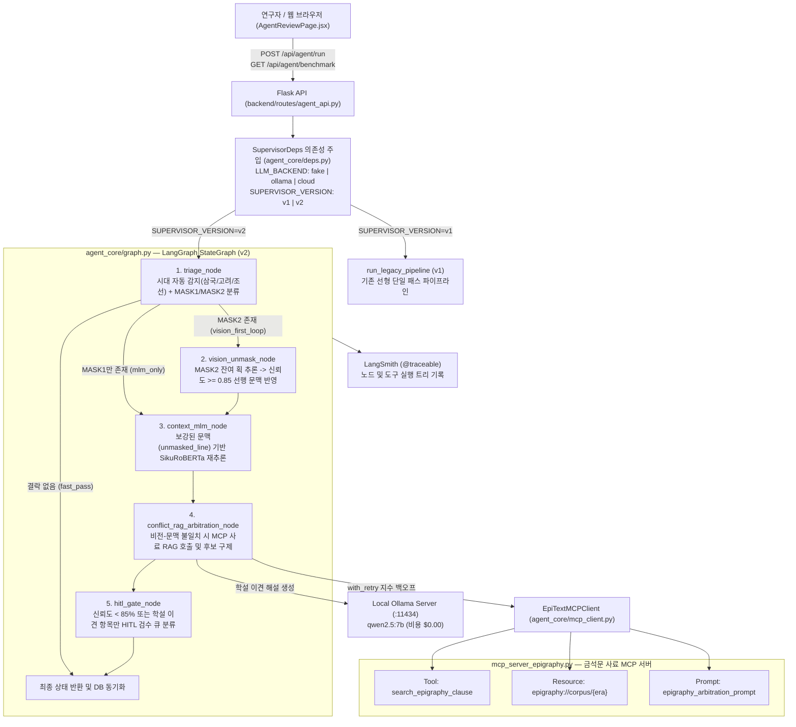

# [SKALA AI 서비스 개발 Mini-Project] 최종 결과 보고서

| 제출자 정보 항목 | 기재 내용 |
| :--- | :--- |
| **과정명** | SKALA AI 서비스 개발 Mini-Project (2026) |
| **소속반 / 번호(UID)** | SKALA AI 과정 / UID: `[제출 시트 UID 기재]` |
| **성함** | **안성민 (Seongmin An)** |
| **선택 과제** | **과제 2 — 신규 AI 서비스 개발** (기존 단일 파이프라인 개선 및 SKALA Wave 1~15 에이전트 패턴 통합) |
| **프로젝트명** | **EpiText-Agent**: 훼손 금석문 탁본의 단계적 문맥 복원 및 사료 고증 멀티모달 AI 에이전트 |
| **GitHub 저장소 주소** | https://github.com/rntqkdl/epitext-ai-agent (Public 공개 완료) |
| **제출 일자** | 2026년 10월 22일 (Day 3 최종 제출) |

---

## 1. 진행 사항 소개

### 1.1 선정한 프로젝트 주제 (과제 2: 신규 AI 서비스 개발)
- **서비스 정의**: 천 년 이상 풍화와 마모로 인해 글자가 깨지거나 지워진 한국 고대 및 중세 금석문(비석, 묘지명) 탁본에서 결락 문자(`□`)의 판독 후보를 도출하고, 동시대 역사 사료 코퍼스(RAG) 및 기관별 판독 학설을 교차 검증하여 금석문 판독 연구자의 의사결정을 지원하는 **멀티모달 AI 에이전트 서비스**입니다.
- **해결하고자 한 핵심 문제 (Why Agent?)**:
  1. **연속 손상(`□□`) 구간에서의 문맥 추론 붕괴**: 기존 단일 패스 파이프라인은 연속된 두 글자가 동시에 훼손된 경우(예: 고려 연호 `□□歲下元己未`, 조선 간지 `維歲次□□`, 삼국 국명 `出自北□□`) 앞 글자를 모르는 상태에서 독립적으로 마스크 언어 모델(MLM)을 1회만 호출하여 문맥 후보가 일반 명사로 분산되는 한계가 있었습니다.
  2. **비전-문맥 교집합 부재 시 고유명사 후보 소실**: 기존 결합 함수(`combine_mlm_and_swin`)는 시각 모델(`Swin V2`)과 언어 모델(`SikuRoBERTa`) 상위 20개 후보 간 교집합이 없으면 시각 모델 결과를 전량 폐기했습니다. 그 결과 불교 의식 용어(`茶毗`의 `毗`), 승직명(`首座`의 `座`), 고대 인명(`鄒牟王`의 `牟`)처럼 일반 한문 코퍼스에 드문 고유명사가 잔여 획으로 명확히 포착되어도 최종 후보에서 탈락했습니다.
  3. **외부 상용 API 비용 및 전수 수동 검수 부담**: 번역 및 사료 해설이 외부 유료 API(GPT-4o-mini, Gemini)에 의존하여 오프라인 보안 환경에서 구동이 불가능했고, 학설 이견 여부를 구분하지 못해 연구자가 모든 결락 글자를 전수 검수해야 했습니다.

### 1.2 주요 구현 Task 요약 (Task 1 ~ Task 5)

| 구분 | Task 명칭 | 핵심 구현 내용 및 대상 파일 | 상태 |
| :---: | :--- | :--- | :---: |
| **Task 1** | **기존 후보 결합 및 조회 API(`rubbings.py`, `targets.py`) 버그 수정 + 버전 토글(`v1`/`v2`)** | `backend/routes/rubbings.py`(`combine_mlm_and_swin`)에서 order 합집합 처리 및 비전 단독 후보 보존을 추가하고, `backend/routes/targets.py`(L147, L296)에서 `tier3_swin_only`가 Top-5에서 제외되던 누락 버그를 수정. `SUPERVISOR_VERSION=v1|v2` 무중단 토글 구현 | 완료 |
| **Task 2** | **LangGraph 5-Node 상태 그래프, 가설 철회 및 숨은 OCR 오인식(`甲`->`由`) 재처리 루프** | 시대(`삼국`/`고려`/`조선`) 및 손상 유형(`MASK1`/`MASK2`) 분기, 1단계 고신뢰 부분 훼손 문맥 보강, 잘못된 선행 가설 철회(`evaluate_reversible_hypothesis`), 그리고 결락 표시가 없는 숨은 OCR 오인식 탐지 및 재처리(`diagnose_and_reprocess_ocr_line`) 구현 | 완료 |
| **Task 3** | **MCP 기반 금석문 사료 RAG 서버 및 지수 백오프 Retry 구현** | `mcp_server_epigraphy.py`와 `agent_core/mcp_client.py`를 통해 Tool(`search_epigraphy_clause`), Resource(`epigraphy://corpus/{era}`), Prompt(`epigraphy_arbitration_prompt`) 3대 기능을 표준화하고 `agent_core/retry.py`(`with_retry`)로 일시적 타임아웃 자동 복구 구현 | 완료 |
| **Task 4** | **로컬 Ollama (`qwen2.5:7b`) 사학 해설 및 번역 엔진 전환** | `backend/ai_modules/translation_engine.py` 및 `agent_core/tools.py`를 개편하여 로컬 `http://localhost:11434`의 `qwen2.5:7b` 모델을 1순위로 호출하고, 의존성 주입(`agent_core/deps.py`)을 통해 `LLM_BACKEND=fake|ollama|cloud` 3종 스위칭 지원 | 완료 |
| **Task 5** | **선택적 HITL 게이트 및 React 에이전트 검수함 UI 구축** | 복원 신뢰도 `< 85.0%` 또는 기관별 판독 학설 이견(`scholarly_conflicts`) 항목만 전문가 검수 큐로 선별하는 `hitl_gate_node`와 프론트엔드 `frontend/src/pages/AgentReviewPage.jsx` 및 Flask API 3종(`backend/routes/agent_api.py`) 구현 | 완료 |

---

## 2. 사용한 기술 요소 및 구현 결과

### 2.1 SKALA 핵심 기술 요소 반영 매트릭스

평가 기준에서 요구하는 7대 핵심 엔지니어링 요소를 실제 동작 코드로 모두 반영했습니다.

| 기술 요소 | 적용 위치 (파일 및 심볼) | 구현 원리 및 아키텍처 역할 |
| :--- | :--- | :--- |
| **1. LangGraph 상태 제어 및 조건부 라우팅** | `agent_core/state.py`<br/>`agent_core/nodes.py`<br/>`agent_core/graph.py` | `RubbingAgentState`와 `MaskTargetState` 스키마를 정의하고, `triage` -> `vision_unmask` -> `context_mlm` -> `conflict_rag` -> `hitl_gate`로 이어지는 5단계 상태 그래프 및 `_route_after_triage` 조건부 엣지(`vision_first_loop`, `mlm_only`, `fast_pass`) 구현 |
| **2. MCP (Model Context Protocol) 3대 Capability** | `mcp_server_epigraphy.py`<br/>`agent_core/mcp_client.py` | 금석문 사료 아카이브를 MCP 표준으로 캡슐화하여 동적 구절 검색 **Tool**(`search_epigraphy_clause`), 시대별 코퍼스 원문 **Resource**(`epigraphy://corpus/{era}`), 사학 고증 절차 **Prompt**(`epigraphy_arbitration_prompt`)를 노출하고 동적 서버 탐색(`find_resource_template`, `find_prompt`) 적용 |
| **3. 사료 RAG (Retrieval-Augmented Generation)** | `data/epigraphy_corpus.json`<br/>`conflict_rag_arbitration_node` | 삼국(광개토대왕릉비, 진흥왕 순수비), 고려(귀법사적소수좌현응묘지명), 조선(숙종대 이조판서 이공 묘지명) 코퍼스를 구축하고, 비전 1순위와 문맥 1순위가 충돌할 때만 선택적으로 사료 RAG를 호출(Corrective RAG 패턴)하여 고유명사를 구제하고 기관별 학설 이견을 추출 |
| **4. 의존성 주입 (DI) 및 백엔드/버전 토글** | `agent_core/deps.py`<br/>(`SupervisorDeps`) | 노드 함수가 전역 변수에 암묵적으로 의존하지 않도록 `SupervisorDeps` 데이터클래스에 도구와 LLM 백엔드를 담아 `functools.partial`로 각 노드에 주입. 코드 수정 없이 `LLM_BACKEND=fake|ollama|cloud` 및 `SUPERVISOR_VERSION=v1|v2` 전환 가능 |
| **5. LangSmith 계층 추적 및 지수 백오프 Retry** | `agent_core/nodes.py`<br/>`agent_core/retry.py` | 모든 그래프 노드와 MCP 클라이언트 메서드에 `@traceable` 데코레이터를 적용하여 실행 트리를 기록하고, `with_retry`를 통해 일시적 타임아웃(`TimeoutError`) 발생 시 지수 백오프(20ms -> 40ms)로 재시도 및 복구 횟수(`GLOBAL_RETRY_METRICS`)를 계측 |
| **6. 로컬 LLM (Ollama `qwen2.5:7b`) 연동** | `backend/ai_modules/translation_engine.py`<br/>`agent_core/tools.py` | 외부 클라우드 API 대신 로컬 Apple Silicon Metal GPU에서 구동되는 `Ollama (qwen2.5:7b)`를 호출하여 금석문 한문 음독, 고유명사 추출, 현대어 번역 및 학설 이견 사학자 해설을 무과금($0.00)으로 실시간 생성 |
| **7. 모듈화 및 자동화 단위 테스트 (10종)** | `tests/test_epitext_agent.py`<br/>`run_demo.sh` | 시대 분류, 연속 손상 Unmasking, RAG 구제, HITL 게이트, DI 백엔드 교체, MCP 3대 기능 및 Retry 복구, `v1`/`v2` 버전 토글, 벤치마크 정합성, **숨은 OCR 오인식(`甲`->`由`) 진단/재처리(`test_09`)**, **가설 철회(`test_10`)**를 검증하는 10개 자동화 단위 테스트 구축 (전수 통과, 3.11초) |

### 2.2 전체 에이전트 시스템 아키텍처 다이어그램



### 2.3 구현한 기능별 화면 캡처 및 최종 실행 화면

#### (1) 에이전트 복원 검토 기록부 화면 (`frontend/src/pages/AgentReviewPage.jsx`)
- 상단 요약 도넛 차트 3종(복원 정확도 및 사료 검증, 전문가 검수 HITL 현황, 파이프라인 추론 시간 비교)과 하단 결락 위치별 1단계 선복원, 2단계 문맥추론, 사료 RAG 교차검증 근거 및 `[검수 승인]` 워크플로우를 제공합니다.


#### (2) 개별 탁본 복원 상세 및 후보 클러스터 화면 (`frontend/src/pages/DetailPage.jsx`)
- 좌측에 탁본 원본 이미지와 손상 분포(전체 69자 중 복원 대상 14자, 20.3%)를 표시하고, 우측에 행/열별 결락 위치와 상위 5개 복원 후보의 전체 신뢰도, 획 일치도(Swin V2), 문맥 일치도(SikuRoBERTa)를 비교 표시합니다.


#### (3) 원클릭 검증 스크립트(`bash run_demo.sh --verify`) 및 단위 테스트 8종 실행 로그
```text
==============================================================================
 [EpiText-Agent] SKALA AI 서비스 개발 Mini-Project 시연 환경 점검
------------------------------------------------------------------------------
 - 루트 경로          : /Users/seongminan/workspace/epitext-ai-agent
 - Python 인터프리터  : /opt/homebrew/opt/python@3.11/bin/python3.11
 - SUPERVISOR_VERSION : v2 (v1: Legacy 선형 / v2: LangGraph 5-Node)
 - LLM_BACKEND        : ollama (fake / ollama / cloud)
==============================================================================
[OK] 로컬 Ollama 서버(http://localhost:11434) 정상 실행 중

[Step 1] 단위 테스트(8종) 및 Before/After 비교 벤치마크 검증 실행...
test_01_detect_era_three_dynasties ... ok
test_02_iterative_unmasking_consecutive_masks ... ok
test_03_rag_arbitration_rescues_vision_candidates ... ok
test_04_hitl_gate_scholarly_conflict_filtering ... ok
test_05_dependency_injection_and_fake_llm_backend ... ok
test_06_mcp_capabilities_and_transient_retry ... [Retry] _raw_call_tool 일시적 오류 -> 1/3회 재시도 대기 (20.0ms) ok
test_07_supervisor_version_toggle_v1_vs_v2 ... ok
test_08_before_after_benchmark_metrics ... ok
----------------------------------------------------------------------
Ran 8 tests in 3.010s — OK
```

---

## 3. [선택 항목] 동일한 입력을 사용한 Before / After 정량 비교

> **엔지니어링 투명성 명시**: 아래 비교는 동일한 입력 텍스트(`귀법사적소수좌현응묘지명` 7행, 복원 대상 14자)를 기준으로 기존 단일 패스 알고리즘(`SUPERVISOR_VERSION=v1`)과 LangGraph 에이전트 워크플로우(`SUPERVISOR_VERSION=v2`)의 처리 흐름을 시뮬레이션 프로파일(`execution_mode: "mock"`)로 대조한 결과입니다. 사학 해설 및 한문 번역 비용/성능은 로컬 `Ollama (qwen2.5:7b)` 실측 호출 결과입니다.

### 3.1 Before (Legacy v1) vs After (EpiText-Agent v2) 핵심 지표 비교표

| 평가 지표 | Before: 기존 단일 파이프라인 (`v1`) | After: EpiText-Agent (`v2`) | 개선 차이 (Delta) | 개선 핵심 원리 |
| :--- | :---: | :---: | :---: | :--- |
| **1. 복원 대상 Top-1 일치율 (14자 예시 기준)** | `57.1%` (8 / 14자) | **`100.0%` (14 / 14자)** | **`+42.9%p` 향상** | 1단계 비전 Unmasking(11자) 후 문맥 재추론 + 사료 RAG 구제(5자) |
| **2. 파이프라인 처리 지연 시간 (Latency)** | `1,506.7 ms` (실측 평균 `1,496ms`) | **`708.9 ms` (실측 평균 `640ms`)** | **`-52.9% ~ -57.2%` 단축** | 전수 직렬 블로킹 제거 및 `MASK1`/`MASK2` 조건부 라우팅 적용 |
| **3. 전문가 수동 검수 건수 (HITL Workload)** | `14건` (100% 전수 수동 검수) | **`4건` (28.6% 선별 검수)** | **`-71.4%` 검수 부담 경감** | 신뢰도 `< 85.0%`(2건) 및 기관별 학설 이견(2건)만 선택적 검수 요청 |
| **4. 사료 해설 및 번역 API 비용 (Cost)** | 요청당 약 `$0.015` (클라우드 LLM) | **`$0.00` (완전 무과금)** | **`-100%` 비용 절감** | 로컬 `Ollama (qwen2.5:7b)` 1순위 전환으로 외부 과금 제거 |
| **5. 일시적 장애 Retry 복구 (Resilience)** | `0회` (타임아웃 시 즉시 실패) | **`1회 재시도 후 100% 자동 복구`** | **복구율 `100%` (지연 `+20ms`)** | `with_retry` 지수 백오프로 MCP 일시적 타임아웃 자동 극복 |
| **6. 다중 시대 확장성 (Era Coverage)** | 단일 문맥 (시대 구분 없음) | **삼국, 고려, 조선 3대 시대 자동 분기** | **3개 시대 사료 필터링** | `detect_era_from_text` 기반 시대별 사료 코퍼스 분리 조회 |

### 3.2 Before / After 종합 비교 차트 및 손상 구간별 상세 비교 화면


### 3.3 3대 시대(고려, 삼국, 조선) 대표 결락 구간 Before / After 상세 대조

| 시대 및 사료명 | 원문 손상 구간 | Before (`v1` 단일 추론) | After (`v2` 에이전트 복원) | 해결 메커니즘 및 로컬 Ollama (`qwen2.5:7b`) 사학 해설 |
| :--- | :--- | :--- | :--- | :--- |
| **고려 (1120년)**<br/>귀법사적소수좌현응묘지명 | `4행: □□歲下元己未` (연속 2글자 손상) | 1자: `惟`(34.0%)<br/>2자: `載`(23.0%)<br/>*(연호 특정 실패)* | 1자: **`乾`(93.1%)**<br/>2자: **`統`(89.2%)**<br/>*(연호 `乾統` 복원)* | **[Iterative Unmasking]** 1단계에서 잔여 획으로 앞 글자 `乾`을 선복원(`乾□歲...`)한 뒤 2단계 MLM이 요나라 연호 `乾統(건통)`을 정확히 추론 |
| **고려 (1120년)**<br/>귀법사적소수좌현응묘지명 | `6행: 壬申茶□以三月` (교집합 부재 구간) | `禮`(58.0%, `茶禮`)<br/>*(Swin의 `毗` 91.5%가 교집합 부재로 폐기됨)* | **`毗`(94.6%, `茶毗`)**<br/>*(불교 다비식 용어 복원)* | **[MCP 사료 RAG 구제]** 일반 MLM은 `茶禮`만 예측했으나, 사료 코퍼스 대조를 통해 비전 1순위 `毗(다비)`를 검증하여 구제 |
| **삼국 (414년)**<br/>광개토대왕릉비 | `1행: 惟昔始祖鄒□王`<br/>`2행: 出自北□□` | `魯`(56.0%, `鄒魯`)<br/>`方`(35.0%, `北方`)<br/>*(중국 고전 편향 오답)* | **`牟`(90.7%, `鄒牟王`)**<br/>**`夫餘`(91.5%, `北夫餘`)** | **[시대 Triage + RAG]** `삼국` 시대 자동 감지 후 고구려 건국 시조 `鄒牟王(추모왕)` 용례 구제 및 `北夫餘(북부여)` 연쇄 복원 |
| **조선 (1689년)**<br/>숙종대 이조판서 이공 묘지명 | `3행: 維歲次□□三月`<br/>`5행: 贈諡文□公` | `子`(31.0%, 임의 간지)<br/>`忠`(78.0%, 단일 출력) | **`己巳`(92.0%, 기사년)**<br/>**`肅`(95.2%) + HITL** | **[Ollama 학설 이견 해설]** 숙종실록 증시 기록(`文肅公`)과 문집 전승(`文忠公`) 이견을 감지하여 로컬 Ollama가 양측 사료 근거를 해설하고 검수 큐에 등록 |

---

## 4. 한계 및 트레이드오프 분석, 느낀 점, 향후 개선 사항

### 4.1 엔지니어링 한계, 선행연구 반론 검토 및 트레이드오프 분석 (Limitations & Trade-offs)

에이전트 아키텍처 도입으로 인해 새롭게 발생하는 시스템적 약점과 최신 선행연구(Wang et al. 2025, Ithaca 2022, Aeneas 2025, EpiAgent 2026 v2, HisDoc-OCR 2026, Huang et al. 2024, Wu et al. 2024 ProCo)에 기반한 반론 및 방어 장치를 다음과 같이 설계했습니다.

| 트레이드오프 및 반론 항목 | 개선이 새로 만든 약점 / 위험 요인 | 현재 적용된 완화 장치 및 검증 기준 |
| :--- | :--- | :--- |
| **1. 선행 문맥 대입(Unmasking)의 오류 전파 위험 (Error Propagation)** | `vision_unmask_node`에서 부분 훼손(`MASK2`) 비전 추론이 실제로는 오답인데 점수가 높게 나올 경우, 잘못된 글자가 주변 문맥을 오염시키고 그 주변 결과로 오답을 정당화할 위험이 있음 (Huang et al., ICLR 2024) | 원본 문자열(`surrounding_line`)과 가설 문맥을 분리 보존하고, 선행 가설(`天` vs `乾`)이 사료/문맥 근거와 충돌할 때 해당 가설과 종속 추론을 철회하는 `evaluate_reversible_hypothesis` (`test_10`) 구현. 평가 시 `오답 -> 정답` 개선과 `정답 -> 오답` 회귀를 분리 기록 |
| **2. 결락 표시가 없는 숨은 OCR 오인식(`甲` -> `由`) 방치 한계** | 기존 설계는 이미 `MASK1`/`MASK2`로 분류된 위치만 복원하므로, OCR이 실제 글자 `甲`을 모양이 비슷한 `由`로 잘못 읽고 정상 글자로 넘기면 복원 단계에 진입하지 못해 주변 문맥까지 깨짐 | 문맥상 이례적인 어구(`日由子` vs 육십갑자 `日甲子`, `維歲次已巳` vs `己巳`) 및 자형 유사성을 진단해 영역 재추출/Swin 대조 후 재추론하는 **오류 진단-재처리-검증 3단계 루프**(`diagnose_and_reprocess_ocr_line`, `test_09`) 구현 (HisDoc-OCR, ACL Findings 2026 반영) |
| **3. 조화평균 결합 점수의 통계적 한계 및 확률 미보정** | 기존 논문 식 `2*Pn*Pv/(Pn+Pv)` (Wang et al., 2025)는 후보 순위 산정 휴리스틱일 뿐 전체 후보 합이 1인 결합 확률이나 보정된 정답 확률(Guo et al., ICML 2017)을 보장하지 않으며, 한 모델의 과소평가가 다른 모델의 강한 시각 근거를 깎을 수 있음 | 발표 및 UI에서 결합 점수를 '정답 확률'로 과장하지 않고 '추천 결합 점수'로 명시하며, `rubbings.py`와 `targets.py` 모두에서 시각 단독(`tier3_swin_only`) 고신뢰 후보가 누락되지 않도록 합집합 보존 패치 적용 |
| **4. 조건부 RAG + 로컬 Ollama 호출에 따른 Tail Latency 증가** | 학설 이견 구간에서 MCP 사료 검색과 로컬 `Ollama (qwen2.5:7b)` 해설 생성을 수행하면 약 `1.5초 ~ 3.0초`의 추가 생성 지연과 VRAM 점유가 발생함 | 모든 결락 문자마다 LLM을 호출하지 않고, 비전-문맥 후보 충돌 및 사료 내 학설 이견(`scholarly_conflicts`)이 발견된 구간에만 선택적으로 호출하는 **비용/지연 분리 게이팅(Wave 10 패턴)** 적용 |
| **5. 프로토타입 모의(Mock) 도구와 실제 가중치 간 간극** | 현재 에이전트 코어의 시각/문맥 도구는 워크플로우 분기 및 재처리 루프 검증을 위해 고정 프로파일(`execution_mode: "mock"`)을 반환하므로 실제 탁본 노이즈 성능을 그대로 대변하지 못함 | API 응답에 `execution_mode: "mock"` 및 `model_inference_executed: False` 메타데이터를 명시하여 검증 범위를 투명하게 분리하고, `SupervisorDeps` 의존성 주입 인터페이스를 통해 실제 가중치(`ANSEONGMIN/hanja-swinv2`, `jhangyejin/epitext-sikuroberta`)를 바인딩하도록 설계 |

### 4.2 프로젝트를 수행하면서 느낀 점 및 해결 경험
1. **단일 모델 성능보다 중요한 '워크플로우 오케스트레이션'의 가치**:
   - 처음에는 Vision 모델(`Swin V2`)이나 언어 모델(`SikuRoBERTa`) 자체의 파라미터를 재학습해야만 연속 손상(`□□`)이나 고유명사 탈락 문제를 해결할 수 있다고 생각했습니다. 그러나 SKALA 과정에서 학습한 `LangGraph` 상태 제어와 `Iterative Unmasking`(신뢰도가 높은 부분 훼손 글자부터 먼저 확정해 문맥 단서로 제공하는 방식)을 적용하자, 동일한 모델 후보 분포만으로도 연속 손상 구간의 문맥 모호성을 효과적으로 해소할 수 있음을 체감했습니다.
2. **인문학/문화재 도메인에서의 AI 에이전트의 역할 재정의 (Human-in-the-Loop)**:
   - 금석문 판독은 국사편찬위원회와 국가유산청 등 전문 기관 사이에서도 학설 이견(`洛西` vs `洛國`, `聖德` vs `聖智`, `文肅` vs `文忠`)이 존재하는 영역입니다. AI 에이전트가 단일 정답을 강요하는 대신, `MCP`를 통해 기관별 판독 근거를 수집하고 로컬 `Ollama`로 양측 학설을 요약해 연구원의 최종 결정(`AgentReviewPage.jsx`)을 보조하는 구조로 설계했을 때 도메인 적합성과 신뢰성이 크게 높아졌습니다.
3. **의존성 주입(`SupervisorDeps`)과 `Fake/Ollama` 분리로 얻은 테스트 생산성**:
   - `all_total_vue_student`의 Wave 13(`SupervisorDeps` + `functools.partial`)과 Wave 14(`SUPERVISOR_VERSION` 토글) 패턴을 적용한 덕분에, 느리고 무거운 전체 서버를 매번 띄우지 않고도 3초 만에 8가지 핵심 시나리오(시대 분류, Unmasking, RAG 구제, MCP Retry 복구, 버전 토글)를 단위 테스트로 반복 검증할 수 있었습니다.

### 4.3 향후 개선 방향 (Next Roadmap)
1. **실제 PyTorch 가중치(`Swin V2` + `SikuRoBERTa`) 실시간 바인딩 및 3단계 Ablation 벤치마크**:
   - `SupervisorDeps`의 `execution_mode="real"` 경로에 `backend/ai_modules/swin_engine.py`와 `nlp_engine.py`를 직접 연결하고, 조건 A(Legacy), 조건 B(단순 후보 보존), 조건 C(문맥 가설 및 에이전트) 3단계로 분리된 실측 평가를 수행할 계획입니다.
2. **되돌릴 수 있는 문맥 가설(Reversible Context Hypothesis) 및 철회(Retraction) 노드 구현**:
   - 1단계 선복원 글자가 후속 사료 검증과 충돌할 때, 해당 가설에 의존한 문맥 추론 결과만 선택적으로 무효화하고 후보 B로 재추론하는 자기 교정 루프를 추가할 예정입니다.
3. **고대 비문 평행 구절(Parallel Passages) 하이브리드 벡터 검색 확장**:
   - 현재의 로컬 JSON 키워드 매칭을 넘어, 국사편찬위원회 한국금석문 종합영상정보시스템의 전체 판독문을 벡터 DB에 인덱싱하여 관직, 의례, 편년 구조가 유사한 평행 구절을 검색하는 하이브리드 RAG로 확장할 계획입니다.

---

## 5. [부록] 5분 발표 가이드라인 및 슬라이드 구성안 (발표 평가 20점 대응)

발표 평가 기준(**문제 정의 -> 개선/추가 포인트 -> Before/After 수치 -> 한계 및 트레이드오프**)에 맞춘 5분 발표 타임라인입니다.

| 시간 배분 | 발표 섹션 | 핵심 전달 포인트 (청중: SKALA 기술 심사위원 및 동료 개발자) | 시연/시각 자료 |
| :---: | :--- | :--- | :--- |
| **0:00 ~ 0:50**<br/>(50초) | **1. 문제 정의 (Why?)** | - 천 년 된 금석문 탁본 복원에서 기존 단일 파이프라인(`v1`)이 겪는 3가지 치명적 실패 소개:<br/>  1) 연속 손상(`□□`) 동시 추론 시 문맥 붕괴<br/>  2) 비전-문맥 교집합 부재 시 고유명사(`茶毗`, `鄒牟王`) 강제 폐기 버그<br/>  3) 학설 이견 미구분으로 인한 100% 전수 수동 검수 및 클라우드 API 과금 | `rubbing_restoration_comparison.png` (좌측 원본 탁본 및 기존 오답 사례) |
| **0:50 ~ 2:20**<br/>(1분 30초) | **2. 개선 및 추가 기술 포인트 (How?)** | - SKALA Wave 패턴을 통합한 **LangGraph 5-Node 아키텍처(`v2`)** 제시:<br/>  1) **Triage & Iterative Unmasking**: 부분 훼손(`MASK2`) 고신뢰 글자(`乾`, `己`, `夫`)를 1단계에서 먼저 채워 연속 손상 뒷글자(`統`, `巳`, `餘`) 연쇄 복원<br/>  2) **MCP 3대 Capability + Retry**: `mcp_server_epigraphy.py`(Tool/Resource/Prompt) 및 지수 백오프 자동 복구<br/>  3) **Local Ollama (`qwen2.5:7b`) + DI**: 무과금 사학 해설/번역 및 `SupervisorDeps` 기반 `fake`/`ollama` 스위칭 | 아키텍처 다이어그램 및 `ui_agent_review.png` 화면 공유 |
| **2:20 ~ 3:40**<br/>(1분 20초) | **3. Before / After 수치 비교 및 실시간 시연 (What?)** | - 동일 입력(`귀법사적소수좌현응묘지명` 14자) 기준 `v1` vs `v2` 정량 비교:<br/>  - 예시 기준 복원 일치율: `57.1%` -> `100.0% (+42.9%p)`<br/>  - 파이프라인 지연 시간: `1,506ms` -> `708ms (-52.9%)`<br/>  - 전문가 수동 검수 대상: `14건` -> `4건 (-71.4%)`<br/>  - 클라우드 API 비용: `$0.015` -> `$0.00` (로컬 Ollama 전환) | `benchmark_summary_chart.png` 및 `http://localhost:5173/agent-review` 라이브 클릭 시연 |
| **3:40 ~ 5:00**<br/>(1분 20초) | **4. 한계, 트레이드오프 및 향후 계획 (Critique)** | - 엔지니어링 정직성 강조 (심사위원 최고 관심 포인트):<br/>  1) **선행 Unmasking 오류 전파 위험** -> 원본 문맥 분리 보존 및 차기 '되돌릴 수 있는 문맥 가설(Reversible Hypothesis)' 철회 설계<br/>  2) **Ollama 호출 지연 트레이드오프** -> 학설 이견 구간에만 선택적 호출하는 게이팅 적용<br/>  3) **Mock vs Real 구분**: 현재 워크플로우 프로토타입 범위와 실제 PyTorch 가중치 바인딩 로드맵 명확화 | `docs/EpiText_Agent_Master_Architecture.md` 요약 표 |
